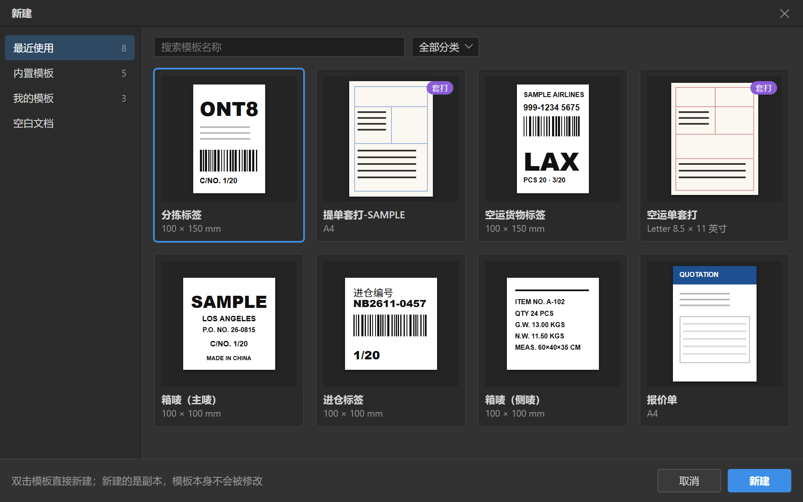
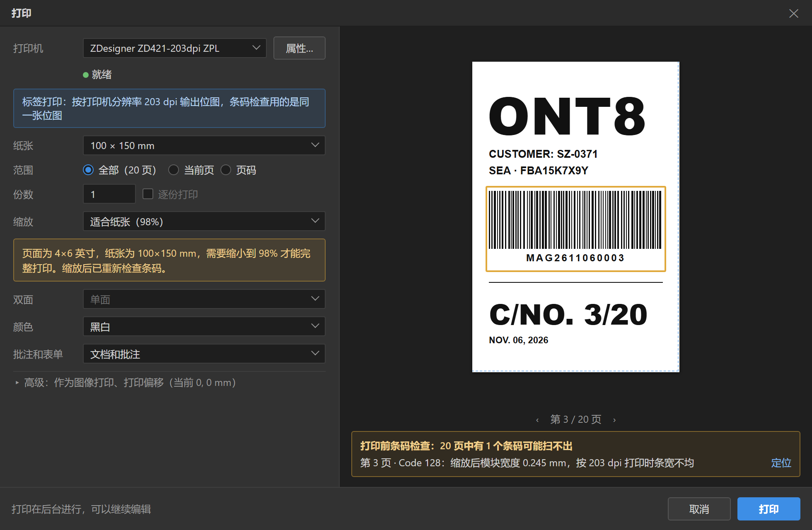
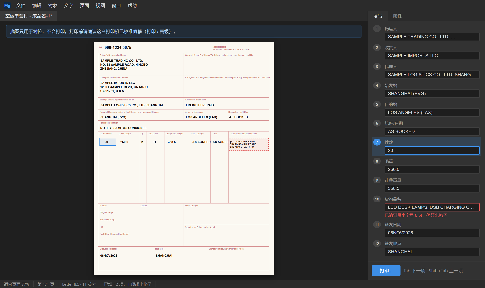

# MagPDF 交互设计

| 项 | 内容 |
|---|---|
| 版本 | v0.1 |
| 状态 | 草案。第 2–5 节和 6.1–6.3 在 P1 开工前定稿；P2、P3 的对话框在各自阶段开始前细化 |
| 日期 | 2026-11-06 |
| 负责人 | 界面组设计人员 |
| 依据 | 《MagPDF 技术方案》v0.9：第 8 节（主界面图和视觉规范已定，附录 A4）、9.4、第 10、11 节 |

方案 8.2 的主界面图和 8.3 的视觉规范已经定稿，本文补充交互细节：选择与变换、文字编辑、组件、面板、对话框、右键菜单、快捷键、提示文案。本文的界面图和主界面图用同一套方法制作，源文件是 `images/ui-dialogs.html`。

---

## 1. 通用约定

- **单位**：默认 mm，偏好设置可改为 pt 或 px。
- **数值输入**：在标签上左右拖动改值；支持表达式，如 `120+10`；上下方向键 ±1 个单位，Shift ×10；回车确认，Esc 还原（方案 8.3）。
- **打断用户的原则**：能不打断就不打断，提示形式见第 9 节。

## 2. 选择与变换

### 2.1 选择

| 操作 | 行为 |
|---|---|
| 单击 | 选中光标下最上层的可见对象，跳过看不见的对象（方案 4.3） |
| Shift + 单击 | 加选或减选 |
| 拖框 | 碰到即选中；选项栏可改为"完全框住才选中" |
| 右键 | 菜单顶部列出光标下的全部对象，可直接选择（方案 4.3） |
| Ctrl + A | 选中当前页全部未锁定的对象 |
| Esc | 取消选择 |
| 悬停 | 对象显示细线轮廓，预先提示单击会选中谁 |

- 锁定的对象不能在画布上点选或框选，只能在图层面板里选中，此时属性只读。
- 编组和组件单击选中整体。双击编组进入隔离编辑，其他对象变淡；双击组件，文字类组件进入原位编辑，其他组件把焦点移到属性面板的参数（方案 11.3）。
- 双击 Form XObject 进入内部编辑；它被多处引用时，先提示"复制为独立副本再编辑"（方案 4.1）。
- 选中的显示：1px 强调色框加 8 个白底方形控制点（方案 8.3）；多选时显示合并的包围盒。

### 2.2 变换

| 操作 | 行为 |
|---|---|
| 拖动对象 | 移动；按 Shift 限定为水平、垂直或 45° |
| Alt + 拖动 | 复制并移动 |
| 方向键 | 微移 0.1 mm（偏好设置可改），Shift ×10 |
| 拖角控制点 | 缩放；Shift 等比，Alt 以中心为基准 |
| 拖边中点 | 单向缩放；按住 Ctrl 拖动为斜切 |
| 控制点外侧拖动 | 旋转；Shift 以 15° 为一档 |
| Ctrl + T | 自由变换（方案 8.4） |

- **吸附**：拖动时吸附页面边缘和中线、其他对象的边和中心、参考线、网格，并显示间距标注；按住 Ctrl 暂时关闭吸附。
- **实时反馈**：拖动时光标旁显示 ΔX/ΔY、W/H 或角度。
- **条码类组件的缩放**：拖动时实时显示换算出的模块宽度和条高；松开后按参数重新生成，并取整到打印点（方案 11.3、11.5），不是拉伸图形。

### 2.3 隐藏对象

- 图层面板的眼睛图标只在本次编辑中隐藏对象，不改文档（《接口协议》`view.setHidden`）。
- 隐藏的对象不显示、不参与点选、不打印、不导出。
- 保存时如果还有隐藏的对象，提示"有 3 个对象处于隐藏状态，保存后在其他阅读器里仍然可见"，按钮为"恢复显示""删除这些对象""照常保存"。

### 2.4 撤销

- 每个提交的操作是一条记录，连续拖动合并成一条（方案 4.2）。
- 历史记录面板点击任意一步即跳回；跳回后再做新操作，后面的记录被丢弃。

## 3. 文字编辑

### 3.1 进入与退出

- P1：用选择工具双击文字，进入原位编辑框（方案 5.5）。P2 起也可以用文字工具单击文字进入。
- 编辑框是文字块外围的强调色虚线框；光标、选区和输入法候选窗跟随文字位置。
- 提交：单击编辑框外，或按 Ctrl + Enter；P1 只有单行时，Enter 也提交。
- 放弃：按 Esc，恢复编辑前的样子。

### 3.2 字体被替换

用到方案 5.2 的第二、三级回退时：
- 编辑框旁边显示一行提示："字体已替换：原字体缺少"柒"字，这个字用了思源黑体"。
- 被替换的字在编辑状态下加橙色点状下划线；状态栏和字符面板同时提示。

### 3.3 不能修改的文字

- 双击没有字符映射的文字时提示："这段文字没有字符映射，不能直接修改，可以整体移动和缩放"（方案 5.1、8.6）。
- 双击扫描页上的文字时提示："扫描件改字将在后续版本提供；目前可以搜索、复制识别出的文字"。

## 4. 组件

### 4.1 置入

- **拖入**：从组件面板拖到页面，显示半透明预览并吸附参考线，松开即置入（方案 11.3）。
- **点击置入**：单击组件进入置入状态，光标变成十字加组件图标；在页面上单击按默认尺寸放置，或拖出一个框决定尺寸；按 Esc 取消，回到原来的工具。
- **置入以后**：组件处于选中状态，属性面板切到参数，光标落在第一个输入框（如条码内容）。
- 保真校验未通过的页面也能置入组件，因为这只是叠加内容（方案 2.3）。

### 4.2 参数编辑

- 属性面板按参数定义自动生成（《组件参数定义》第 2 节）。
- 输入时实时校验：错误标红，警告标黄，说明写在输入框下方。
- 停止输入 300 ms 后重新生成并刷新画布，整次修改是一条撤销记录。
- 条码类组件在参数下方显示检查结果：回读验证、尺寸、静区、颜色（见方案 8.2 的界面图）。
- 置入印章时从印章库选择（带缩略图）；设了密码的印章弹出密码框（P3）。

### 4.3 组件状态

| 状态 | 画布上 | 图层面板里 |
|---|---|---|
| 正常 | 无标记 | 组件图标 |
| 有警告 | 选框右上角黄色三角 | 黄色三角 |
| 有错误 | 红色圆点 | 红色圆点 |
| 被其他软件改过 | 灰色感叹号 | 提示"内容已被修改"，右键可重新生成或解散（方案 11.4） |
| 版本高于软件 | 锁形图标 | 提示"需要更新软件才能修改" |

## 5. 面板

### 5.1 组件面板

- **搜索**：按名称或拼音首字母，如输入 `dfz` 找到"电放章"所在的文字章；搜索时显示平铺的结果列表。
- **视图**：网格（每格 72×72，带预览）或列表（行高 24 px）（方案 8.3）。
- 记住每个分类的展开状态；"最近使用"最多 6 个。
- 悬停 600 ms 显示大图和说明。
- 宽度可拖动（200–400 px），可折叠成图标条或隐藏（窗口 > 组件）。

### 5.2 图层面板

- 树形结构：页 → 编组、组件、对象；自动分组，虚拟列表（方案 4.3）。
- 每行依次是：眼睛、锁、类型图标、名称（双击改名）、状态标记。
- 拖动调整层级，可以拖进、拖出编组；Shift、Ctrl 多选。
- 画布和图层面板的选中状态双向同步；在画布上选中时，图层面板自动展开并滚动到该行。
- 可按类型（T 文字、P 路径、I 图像、C 组件）和名称筛选。
- 套打底图所在的不打印图层带"不打印"标记（方案 10.6）。

### 5.3 属性面板

- 内容随选中对象的类型切换（方案 8.5）。多选时显示共有的属性，各对象取值不同的显示"—"。
- 保真校验未通过的页面上，原有对象的属性只读，面板顶部说明原因。

### 5.4 页面面板

- 缩略图用虚拟列表；拖动重排；可多选。
- 缩略图上显示扫描页图标和保真校验角标（方案 8.6）。
- 右键菜单见第 7 节。

### 5.5 其他面板

历史记录、识别、字体、信息、导航器、颜色和色板、字符和段落面板的内容见方案 8.5。在默认的"货代单证"工作区里，它们折叠在右侧的图标条中（方案 8.2 的界面图）。

## 6. 对话框

### 6.1 启动页与新建（Ctrl + N）

- 左侧分组：最近使用、内置模板、我的模板、空白文档；右侧是缩略图网格，可搜索、按分类筛选（方案 10.4）。
- 每张卡片显示名称、纸张尺寸；套打模板带"套打"标记。
- 双击卡片或选中后点"新建"，生成一份"未命名-n"副本。
- 选"空白文档"时，右侧改为纸张设置：尺寸预设（A4、Letter、100×150、100×100、4×6 英寸、60×40、50×30 mm，方案 11.7）或自定义，方向，页数。

### 6.2 存储为模板

- 填写：名称、分类（可新建分类）、类型（普通模板，或文档里有不打印图层时可选套打模板）。
- 检查结果区按方案 10.3 列出：保真校验未通过的页、尚未识别的扫描页、只嵌入了子集的字体。字体一项可勾选"补全常用汉字"，并显示每款字体增加的大小。
- 锁定状态沿用各对象自己的设置；对话框里显示已锁定对象的数量，并提示"可在图层面板锁定抬头、Logo 等固定内容"。

### 6.3 打印（Ctrl + P）

左侧是设置，右侧是预览（方案 9.4）。

- **设置区**，从上到下：打印机（带"就绪""脱机"状态，旁边的"属性"按钮打开驱动设置）、纸张、范围、份数和逐份打印、缩放、双面、颜色、批注和表单；"高级"折叠区里是"作为图像打印"和打印偏移 X/Y，以及"打印校准页…"按钮。
- **标签打印机**：选中热敏标签打印机时，设置区顶部显示"标签打印：按打印机分辨率 203 dpi 输出"。页面尺寸和纸张不一致时显示黄色提示条，并给出缩放建议（方案 11.7）。
- **预览**：按所选纸张和缩放实时显示，可翻页；内容超出打印机可打印区域时用红色斜线标出；不打印图层不显示。
- **条码检查结果**（方案 11.5）：预览下方列出有问题的条码（页码和原因），点击在预览里定位。有问题时，"打印"按钮要再确认一次。
- 点"打印"后对话框关闭，打印在任务进程里进行，状态栏显示进度，可以取消（方案 3.3）。

### 6.4 打印校准

用于套打（方案 10.6），在打印对话框的"高级"里打开：
1. 确认打印机和纸张。
2. 点"打印校准页"：在白纸上打出十字线和毫米刻度，页面上写着"把这张纸叠在预印单据上，对着光读出偏差"。
3. 输入读出的偏差：向右为正的 X，向下为正的 Y，单位 mm。
4. 保存到这台打印机；可以再打一张校准页验证。

### 6.5 批量生成（按序号，P2）

- 入口：文件 > 批量生成…。
- 填写：总数 N、起始值、步长，默认取页面上序号组件的参数。
- 预览前 3 张和最后 1 张的序号与条码内容。
- 点"生成"后先逐个序号检查（方案 11.7），有错误时列出序号、字段和原因；没有错误则在任务进程里生成，状态栏显示进度，可取消。完成后打开新文档。

### 6.6 按网格拆分（P2）

- 左边预览原页面，叠加网格线；右边是设置：预设网格（1×2、2×2、2×3、3×2）或自定义行列、页边距、输出的标签尺寸。
- "自动检测"按钮按页面上的空白带推断网格（《货代业务规则》2.5）。
- 拆分后自动做打印前条码检查。

### 6.7 套打（P3）

**新建套打模板**（文件 > 新建套打模板…），分四步：
1. 选择空白单据的扫描件或 PDF 作底图。
2. 用裁剪工具把页面裁到单据边缘。
3. 尺寸校正：在底图上点两个点，输入它们的实际距离，底图等比缩放；尺寸准确时可跳过。
4. 底图自动放进"不打印"图层并锁定，随后进入编辑，组件面板展开，提示"在格子里放字段，再设置填写顺序"。

**设置填写顺序**：编辑模板时，选"视图 > 显示填写顺序"，每个字段上显示序号徽章；按想要的顺序依次单击字段，即重新编号。

**填写视图**：从套打模板新建文档后，属性面板顶部切换到"填写"页：
- 按顺序列出全部字段，每项是名称和输入框；Tab、Shift + Tab 在字段之间移动，画布同步高亮当前字段并滚动到可见。
- 内容超出格子、缩到最小字号仍放不下的字段标红（方案 8.6）。
- 底部有"打印…"按钮。页面顶部的提示条写明"底图只用于对位，不会打印"。

### 6.8 偏好设置（Ctrl + K）

| 分页 | 内容 |
|---|---|
| 常规 | 单位、界面灰度（4 档）、启动时显示启动页 |
| 编辑 | 历史记录步数（默认 50）、微移步长、恢复文件间隔（默认 2 分钟）、吸附 |
| 识别 | 打开扫描件时自动识别、保存时写入文字层、识别模型、GPU 加速、清空识别缓存 |
| 模板 | 附加的模板文件夹（如同步盘里的文件夹） |
| 打印 | 各台打印机的打印偏移，可修改、删除 |
| 更新 | 自动检查更新 |
| 关于 | 版本、授权信息、第三方许可声明 |

### 6.9 其他对话框

- **密码**：打开有密码的文档时输入打开密码；编辑或打印受权限限制的文档时输入权限密码（方案 8.6、9.4）。
- **已签名的文档**：标题栏下方显示提示条（方案 9.2）；选"优化保存"时说明为什么不可用。
- **崩溃恢复**：启动时列出可恢复的文档（文件名、上次修改时间），逐个选择恢复或放弃（方案 9.3）。
- **引擎重启**：引擎崩溃并自动恢复后，右下角提示"程序遇到问题，已自动恢复；最近 2 分钟内的修改可能丢失"。

## 7. 右键菜单

| 位置 | 菜单项 |
|---|---|
| 画布上的对象 | 选择下层对象 ▸（光标下全部对象）｜剪切、复制、粘贴、原位粘贴、复制对象、删除｜编组、取消编组、锁定、隐藏｜排列 ▸ 置顶、上移一层、下移一层、置底｜变换 ▸ 水平翻转、垂直翻转、旋转 90°｜组件：编辑参数、重新生成、解散组件 |
| 画布空白处 | 粘贴、全选、显示参考线、锁定参考线、页面属性 |
| 图层面板 | 重命名、锁定、隐藏、编组、删除；套打模板里另有"移入不打印图层" |
| 页面面板 | 插入空白页、从文件插入、删除、旋转、提取为新文件、按网格拆分（P2）、重新识别文字 |
| 组件面板 | 置入；v1.1 起"我的组件"另有重命名、删除 |

## 8. 快捷键

方案 8.4 列出了工具和常用编辑命令，完整列表如下。所有快捷键都可以自定义，自定义时检测冲突。

| 类别 | 快捷键 |
|---|---|
| 工具 | V 选择、T 文字、U 形状（Shift + U 切换形状）、I 吸管、C 裁剪、H 抓手（按住空格临时切换）、Z 缩放 |
| 文件 | Ctrl + N 新建、Ctrl + O 打开、Ctrl + S 保存、Ctrl + Shift + S 另存为、Ctrl + P 打印、Ctrl + W 关闭、Ctrl + K 偏好设置 |
| 编辑 | Ctrl + Z 撤销、Ctrl + Shift + Z 重做、Ctrl + X / C / V 剪切 / 复制 / 粘贴、Ctrl + Shift + V 原位粘贴、Ctrl + J 复制对象、Delete 删除、Ctrl + A 全选、Esc 取消选择 |
| 对象 | Ctrl + T 自由变换、Ctrl + G 编组、Ctrl + Shift + G 取消编组、Ctrl + ] 上移一层、Ctrl + [ 下移一层、Ctrl + Shift + ] 置顶、Ctrl + Shift + [ 置底、方向键微移（Shift ×10） |
| 视图 | Ctrl + 0 适合页面、Ctrl + 1 实际大小、Ctrl + 加号 / 减号 放大 / 缩小、Ctrl + R 标尺、Ctrl + ; 参考线、Ctrl + ' 网格、Tab 隐藏或显示全部面板（填写视图中用于切换字段，不隐藏面板） |
| 其他 | Ctrl + F 查找、F1 帮助、F6 在面板之间切换焦点 |

## 9. 提示与出错信息

### 9.1 提示的形式

| 形式 | 用途 |
|---|---|
| 状态栏文字 | 进度和轻量的结果，如"已保存" |
| 画布标记 | 对象和组件的状态（4.3），校验位错误的虚线框 |
| 页面顶部提示条 | 整个文档的状态：已签名、有保真校验未通过的页、受权限限制、套打底图不打印 |
| 右下角气泡 | 操作结果，5 秒后消失，如"已生成 120 张""字体已替换" |
| 对话框 | 必须由用户决定的事：关闭前保存、覆盖确认、无法继续的错误 |

### 9.2 文案规则

- 用简体中文直白地说：发生了什么、原因（知道的话）、下一步怎么做。例："无法保存'提单.pdf'：文件正被其他程序占用。请关闭该程序后重试，或另存为新文件。"
- 不向用户显示错误码；诊断信息放在"详细信息"折叠区，方便用户导出诊断包发给技术支持。
- 按钮用动词："保存""不保存""取消"，不用"是""否"。
- 术语和方案的术语表一致。

### 9.3 常见提示文案

| 场合 | 文案 |
|---|---|
| 字体被替换 | 字体已替换：原字体缺少"柒"字，这个字用了思源黑体。 |
| 保真校验未通过 | 第 3 页无法安全修改原有内容：页面使用了软件尚不能完整保留的效果。可以在这一页上添加内容。 |
| 已签名的文档 | 本文档已签名。保存后，签名会显示为"签名后已修改"。 |
| 条码检查不通过 | 第 2 页有 1 个条码可能扫不出：模块宽度 0.24 mm，低于建议的 0.25 mm。 |
| 校验位不对 | 箱号 CSQU3054380 的校验位应为 3。 |
| 页面与纸张尺寸不一致 | 页面为 4×6 英寸，纸张为 100×150 mm，需要缩小到 98% 才能完整打印。缩放后将重新检查条码。 |
| 套打字段放不下 | "货物品名"已缩到最小字号 6 pt，仍超出格子。请精简内容或调大格子。 |
| 标志需要彩色 | 锂电池标记要求红色斜纹，黑白打印不符合规定。请使用预印标签或彩色打印机。 |
| 组件被改过 | 这个条码的内容被其他软件改过。可以按参数重新生成，或解散为普通对象。 |

## 10. 键盘操作与可读性

- 所有功能都能用键盘完成：F6 在面板之间切换焦点；对话框里的 Tab 顺序与视觉顺序一致；焦点框为 2 px 强调色。
- 文字对比度：主文字 `#d6d6d6` 在面板色 `#323232` 上约 8.8:1，次要文字 `#9a9a9a` 约 4.6:1，都不低于 4.5:1。
- 界面随 Windows 显示缩放清晰显示（100%–200%，《测试计划》第 10 节）。
