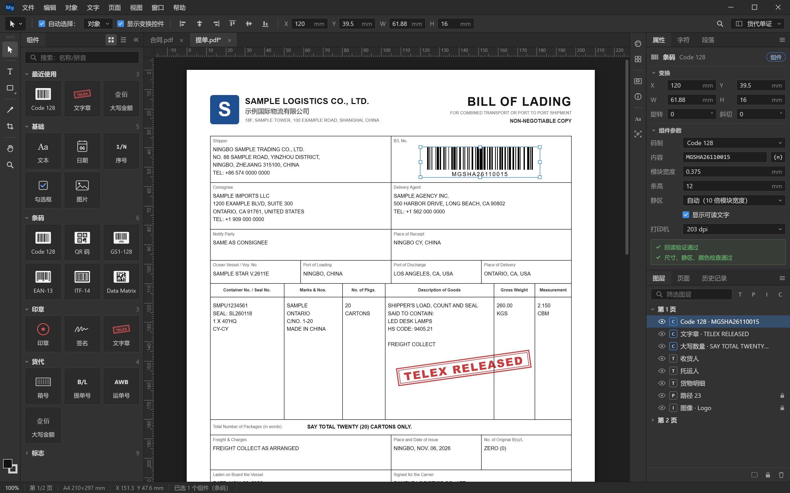

# MagPDF：对象级 PDF 编辑器 技术方案

| 项 | 内容 |
|---|---|
| 版本 | v0.9（修订记录见附录 C） |
| 状态 | 草案，待评审 |
| 日期 | 2026-11-06 |
| 负责人 | 待定 |
| 评审人 | 待定 |

## 摘要
- **做什么**：Windows 桌面 PDF 编辑器。像 Photoshop 一样选中、移动、变换、改样式、删除页面里的每个文字、路径和图像对象；本机 OCR 让扫描件可搜索、可复制，v1.1 起可编辑扫描件里的文字；内置条码、印章等货代常用组件，能批量生成和打印标签，能在预印的提单、空运单上套打。保存时未修改的内容按字节保留，所有处理在本机完成，不需要服务器。
- **给谁用**：处理办公文档、合同、扫描件的个人用户；海运、空运、跨境电商货代的业务人员。
- **关键技术决策**：fork PDFium 并修复它的内容流生成器，不自研解析器（生成器缺陷已对照源码确认，第 2 节）；引擎在独立的原生进程中运行；界面用 Tauri 2 + React；OCR 用 PP-OCRv5 + ONNX Runtime；条码用 Zint 生成、ZXing-C++ 识别。
- **团队与工期**：10 人，P0 技术验证 6 周后分三期开发，约 40 周发布 v1.0。按附录 A1 方案一，段落重排、扫描件改字、按表格批量等移到 v1.1（v1.0 之后约 12 周）；v1.0 工作量粗估约 225–310 人周，中位数比有效产能（约 280–300 人周）低 8% 左右。
- **主要风险**：生成器修复后仍有信息丢失（保真校验兜底，Foxit 试用版作对照）；排期偏紧；标签打印后条码扫不出；GPU 推理接口变动。完整列表见第 15 节。
- **决策状态**：附录 A 的待决问题已全部确定：范围与工期、授权模式、macOS 版、界面设计（A1–A4）。
- **读者指引**：业务读者看摘要和第 1、8、10、11 节以及 9.4（打印）；工程读者看第 2–7、9、12–14 节。各项工作的执行细节见第 17 节列出的配套文档。

---

## 1. 产品定位与范围

### 1.1 前提
| 项 | 结论 |
|---|---|
| 用户 | 处理办公文档、合同、扫描件的个人用户；海运、空运、跨境电商货代的业务人员（提单、托书、装箱单、发票、箱唛、货物标签）。授权用离线授权文件，个人和公司都适用（13.4） |
| 部署 | 纯本地桌面应用：无后端、无账号，文档不离开本机。安装后断网可用全部已安装功能；可选组件和更新从静态下载地址获取，也可用完整版安装包离线安装 |
| 平台 | 只做 Windows 10/11，不开发 macOS 版（附录 A3）。进程通信、打印、GPU 推理直接用 Windows 接口，不做跨平台抽象层 |
| 依赖许可 | 开源依赖均为宽松许可（BSD、MIT、Apache-2.0、OFL，以及 PDFium 自带的 FreeType、zlib、libpng、libjpeg-turbo 等各自的许可），闭源商用和开源都可以；ONNX Runtime 内含的 Eigen 为 MPL-2.0，未作修改，按要求在许可声明里说明源码获取方式（《开源许可与合规清单》）；WebView2 运行时、Windows ML 和 DirectML 是微软组件，按微软条款随系统或安装包分发。每个版本附第三方许可声明（13.4） |
| 团队 | 10 人 |
| 界面风格 | Photoshop（下文简称 PS）深色界面，按第 8 节的界面图和视觉规范执行，不另做参考图（附录 A4） |

### 1.2 核心能力
| 能力 | 说明 |
|---|---|
| 对象级选择 | 页面里的每个文字块、路径、图像、渐变、Form XObject 都是可选中的对象 |
| 自由变换 | 移动、缩放、旋转、斜切、翻转（Ctrl+T），Shift 等比、Alt 以中心变换 |
| 图层面板 | 按页列出对象树：可见性、锁定、改名、拖拽调层级；PDF 可选内容组（OCG）显示为图层 |
| 外观编辑 | 填充/描边颜色、线宽、虚线、不透明度、混合模式；文件里已有的 CMYK 和专色原样保留 |
| 文字编辑 | 原位改字、改字体字号颜色，支持中文；段落重排在 v1.1 |
| 扫描件 | 本机 OCR 识别后可搜索、可复制；把识别出的文字转换为可编辑文字、原位修改在 v1.1 |
| 绘制 | 矩形、椭圆、直线；钢笔和路径锚点编辑放在 P4 |
| 图像 | 置入、替换、裁剪、导出原图 |
| 页面 | 缩略图、插入、删除、旋转、重排、裁剪框 |
| 模板 | 编辑好的文档存为模板，下次从模板新建直接编辑（第 10 节） |
| 内置组件 | 编辑区左侧的组件面板：文本、日期、序号、条码、二维码、印章、文字章（电放章等），以及箱号、运单号、大写金额、包装和危险品标志等货代常用组件；拖到页面即可使用，改参数后自动重新生成（第 11 节） |
| 标签与批量 | 标签尺寸和内置标签模板（箱唛、进仓标签、空运货物标签、分拣标签）；按网格拆分平台标签；按序号批量生成（按 Excel/CSV 批量在 v1.1） |
| 打印 | 普通文档和标签打印，共用一个带预览的打印对话框；标签按打印机分辨率输出，打印前检查条码（9.4、11.7） |
| 套打 | 在预印的提单、空运单等单据上只打印填写的内容：底图只显示不打印，按打印机校准偏移（10.6） |
| 无损保存 | 未改动的内容字节级保留；支持增量保存和完整重写 |

### 1.3 v1.0 不做
XFA 表单、JavaScript 执行、3D/多媒体、创建数字签名、手写内容和竖排文字的编辑、印前专用功能（创建专色、叠印预览、PDF/X 输出）、改写承运人和平台标签上的条码（11.5）。

段落重排、编辑扫描文字、修复画笔、按表格批量生成、拼版、我的组件和单证模板放在 v1.1（14.4）。

### 1.4 竞品与切入点
| 类别 | 代表产品 | 擅长 | 本产品的切入点 |
|---|---|---|---|
| 通用 PDF 编辑器 | Adobe Acrobat、福昕高级 PDF 编辑器、WPS PDF、万兴 PDF | 改文字和图片、OCR、页面管理 | PS 式图层和对象级编辑；货代组件、标签批量生成、打印前条码检查 |
| 标签设计软件 | BarTender、NiceLabel、中琅、ZebraDesigner | 从零设计标签、按数据批量打印、驱动标签打印机 | 直接打开和编辑现成的 PDF：拆分平台导出的标签，修改客户和承运人发来的单证 |

在货代场景里把这两类工具合成一个，是本产品的定位。上表基于公开信息，具体功能和价格对比在 P0 期间通过试用和用户访谈补全（14.2）。

---

## 2. 关键技术决策

### 2.1 引擎：fork PDFium，补全编辑能力
PDFium 的公共 API（`fpdf_edit.h`）已经能枚举、变换、插入、删除页面对象，但它的内容流生成器（`cpdf_pagecontentgenerator.cpp`）写回时有以下缺陷，均已对照上游源码确认：
- 颜色只输出 RGB，灰度色也被改写成 RGB。CMYK、专色、Pattern、ICC 颜色不写颜色操作符，对象会变成黑色。ICCBased 颜色在渲染时经 lcms 按嵌入的配置转换，写回时不能退化为 Alternate 或 DeviceRGB；专色的 `/None` 着色剂必须保持不画。
- 渐变对象（`sh`）被跳过，写回后消失。内联图像（`BI … EI`）同样被跳过，对象整个丢失。
- ExtGState 只合成 `ca/CA/BM`，软蒙版、叠印（`OP/op/OPM`）、文字挖空等参数丢失。V02 合成样本实测：`ca/CA/BM` 确实保留，软蒙版确实丢失；叠印参数不再被引用。
- 文字只写 `Tm Tf Tr` 和一个 `Tj`，`Tc`、`Tw` 只存在文字状态里，不写出；`TJ` 字距上游已于 2026-03 修复（chromium/8138 已含）。`Tz`、`Ts` 在解析时已折算进文字矩阵和起点，能保留。`Tc`、`Tw` 在办公导出里出现频繁，是 V03 的第一项。
- 遇到 Type3 字体的文字直接返回，留下未闭合的 `q` 和 `BT`，同一内容流里后面的对象全部落进这个文字块，整条流损坏。只要改了这条流里的任何对象就会触发。文字裁剪模式（`Tr` 4–7）整体丢失，V02 合成样本里受影响的填充会盖满整页，是画面破坏最大的一项。
- 新插入的对象统一写进页面末尾新建的内容流，画在所有原有对象上面；已有对象调整层级后仍写回原来所在的流，跨流的层级调整不生效。两种情况保存后的层级都与编辑时看到的不一致。
- 多页共用的内容流（各页 `/Contents` 指向同一流对象）被就地改写，其他页的字体资源名随之失配。Form XObject 被多页引用时同理：生成前要先做 copy-on-write。
- 公共 API 缺少：按色彩空间设颜色、设置剪切路径、克隆对象、修改已有文字的字体字号、替换已嵌入字体的数据（保存时子集化需要）、向 Form XObject 插入对象、读写底层对象字典。

原版 PDFium 的往返基线（V02，PDFium 公开测试集 346 个文件）：有对象的页 94.3% 往返无差异，差异全部能归到上面的缺陷；合成样本证实了 `Tc/Tw`、CMYK、Separation、Indexed、Pattern、渐变、软蒙版、内联图像、文字裁剪和 Type3 的丢失。

这些缺陷集中在写出模块，PDFium 内存里的对象模型基本保留了相关信息（字距、`Tc/Tw`、软蒙版、叠印参数都在）。所以做法是 fork 上游 PDFium（BSD-3 / Apache-2.0），修复生成器，补充 `MAG_*` 扩展 API，不再自研解析器。理由：
- 只有一套解析器，选中框和画面一定一致。PDFium 的解析器长期在 Chrome 里接受模糊测试，对不规范文件的兼容性远好于自研。
- 编辑直接作用在 PDFium 的内存对象上，改完立即重绘，不用重新加载文档。
- 省掉了自研解析器、内容流解释器和对象模型，这是 v0.1 里最大的不确定项。

生成器的修复属于缺陷修复，尽量提交回上游，减少分支与上游的差异。EmbedPDF 维护着一个面向编辑的 PDFium 分支，可作参考。

退路：P0 前两周先用原版 PDFium 跑往返测试（每页对象全部标记为已修改，重新生成内容流，再渲染比对），统计丢失了哪些信息。如果有信息在解析阶段就已丢失、无法从对象模型恢复，再评估自研解析层或商用 SDK（2.4）。

备选做法：自研无损内容流读写层。PDFium 仍负责解析、渲染和命中测试，仍是唯一的几何来源；内容流的读写由我们用 Rust 实现。读入时保留原内容流里每个操作符及其字节位置，并和 PDFium 的页面对象按顺序一一对应；保存时只重写改过的对象，其余字节原样保留；改过的和新增的对象由自己的序列化代码写出，不再修补 PDFium 的生成器。
- 好处：没改过的对象不会因为改写丢信息，保真校验不通过的页面会大幅减少；PDFium 分支的改动更少，同步上游更容易。
- 难点：操作符和对象必须严格对上；对不上的页面退回整条内容流重写，再做保真校验。
- 决定方式：P0 做原型，和修补生成器的做法在同一批样本上对比，复盘时选定一条进入 P1（《P0 技术验证计划》V17）。
- 参考代码：可以参考、移植 PDFium（BSD-3 / Apache-2.0）和 pdf.js（Apache-2.0）的代码，保留原版权声明；MuPDF 是 AGPL 许可，不参考它的源码。

整个底层（含渲染）不自研：文件结构、压缩编码、字体、颜色与透明、渲染这些部分做到 PDFium 的水平，粗估要 230 人周以上，v1.0 至少推迟一年。

### 2.2 原生运行，独立进程
桌面应用不需要 WASM。引擎以原生代码运行在独立的引擎进程里：
- OCR 和背景修复模型在原生 ONNX Runtime 上能用满 CPU 的 SIMD 指令和多线程，默认在 CPU 上推理。有显卡时可用 GPU 加速：Windows 11 24H2 起用 Windows ML，更早的系统回退到 DirectML（微软已将 DirectML 转入维护模式，不再增加新功能），P0 评估。
- 没有常见 WASM 构建（32 位）的 4 GB 内存上限，大文件和高分辨率扫描件不受限制。
- 恶意或损坏的 PDF 让引擎崩溃时，界面进程不受影响，可以从恢复文件自动恢复（第 9 节）。

代价是放弃 v0.1 的"同一套代码出 Web 版"。以后需要 Web 版时，PDFium 可以编译成 WASM（EmbedPDF 已验证），界面代码可以复用。

### 2.3 页面改写与保真校验
PDF 内容流里的图形状态会"泄漏"：前一个对象设置的颜色、线宽、`cm` 会影响后面的对象。PDFium 解析后每个对象都带有自己的完整状态，写回时由生成器负责把状态写对。生成规则：
1. 只写状态的变化部分，不给每个对象重复写全部状态，避免文件膨胀。
2. 共用同一剪切路径的连续对象放进同一个 `q…Q` 组，剪切路径只写一次。地图、图表里常见一个剪切路径作用于几千个对象。
3. 文字裁剪（渲染模式 `Tr` 4–7）要求同一个 `BT…ET` 里的字形合起来作为裁剪区域，这样的文字块整体当作一个对象，不拆开。
4. 保留原有标记内容（`BMC/BDC … EMC`）的嵌套。
5. 只重写被编辑过的内容流，未编辑的页面和流原样保留。跨内容流调整层级时，把相关的流合并后重写，保证保存后的层级与编辑器里一致。

保真校验在每页第一次编辑前完成：
- **对象比对**：改写前后各解析一次，逐个比较对象的几何、颜色、字形位置。颜色要比较色彩空间类型和名称，而不只是 RGB 值：PDFium 把 CMYK、灰度换算成等价 RGB 后像素可能完全一致，颜色空间却已经丢了（V14 4.4、V02）。
- **像素比对**：打开所有可选内容图层（否则默认隐藏的图层不会被检查），以 2 倍分辨率渲染后比较。像素比对对"颜色空间被换算成等价 RGB"、叠印参数丢失和文字状态丢失都不敏感（V02、V14），只作两项比对之一，不能单独用来判定无差异。
- **提前进行**：页面显示后，在引擎空闲时于后台完成校验。用户开始编辑时通常已经做完，不用等待。
- **降级**：校验不通过的页面只能叠加内容（新增对象、在上面覆盖），不能修改原有对象。页面缩略图显示角标并说明原因。

### 2.4 商用 SDK 的位置
商用 SDK 替代的是"引擎"这一层：解析、渲染、页面对象接口、内容流写回、文字和字体处理，部分还带 OCR。界面部分（PS 风格外壳、工具、面板、模板）用不用 SDK 都要自己做。

| SDK | 与本项目相关的能力 | 说明 |
|---|---|---|
| Apryse（原 PDFTron） | 段落级的文字编辑、图片移动缩放；原生 SDK 另有底层内容流读写接口 | WebViewer 的内容编辑是单独收费的附加模块，不含在基础授权里 |
| Foxit PDF SDK | 页面对象接口：文字、路径、图像、表单对象的增删改；OCR 模块 | 对象接口较底层，最接近本项目需求；OCR 只支持 Windows 和 Linux x64 |
| ComPDFKit | 文字和图片编辑；OCR 在单独的转换 SDK 里 | OCR 输出为可搜索 PDF |
| MuPDF | 渲染和编辑能力强 | AGPL，闭源使用需购买商业授权 |

价格基本不公开，需要询价。

结论：自研引擎。商用 SDK 能省下生成器修复、文字编辑和 OCR 的一部分工作，但 Apryse、ComPDFKit 现成的内容编辑功能面向文字和图片；路径、渐变、Form XObject、剪切路径的对象级编辑，仍要基于它们的底层对象接口自己实现。10 人团队有能力维护 PDFium 分支；商用 SDK 的价格要逐家询价，授权费是长期成本，面向个人用户的产品难以预估。P0 期间申请 Foxit 试用版，在同一批测试文件上对比保真效果，作为 PDFium 分支的参照和退路。

---

## 3. 总体架构

### 3.1 进程与职责
```
界面进程（WebView2：React + TypeScript）
  ├ 外壳：菜单栏、顶部工具栏与选项栏（同一行）、停靠面板、状态栏
  ├ 画布：瓦片合成（WebGL2）+ 交互覆盖层（选框、控制点、参考线）
  ├ 工具：V T U I C H Z（v1.1 增加 J，P4 增加 A、P），每个工具是一个状态机
  └ 状态：Zustand（选中集、视图、工具参数）；文档数据只持有只读快照
        │
        │ Tauri IPC（命令和查询，JSON）；位图走自定义协议
        ▼
主进程（Rust，Tauri 2）
  ├ 窗口、原生菜单、文件对话框、系统字体枚举
  ├ 模板库、组件库、恢复文件、更新检查
  └ 启动并监控引擎进程和任务进程；引擎崩溃后自动重启并从恢复文件恢复
        │
        │ 命名管道（命令）+ 共享内存（位图）
        ▼
引擎进程（原生 x64：Rust + C++）
  ├ PDFium 分支（C++，含 MAG_* 扩展）：解析、渲染、对象编辑、内容流生成、保存
  ├ 编辑服务：命令与撤销、页面保真校验、命中测试索引、分层渲染
  ├ 文字服务：文字块识别、排版、字体匹配、保存时子集化（HarfBuzz）
  ├ 组件与标签服务：按参数生成组件、条码生成（Zint）与识别（ZXing-C++）、校验位检查、批量生成、打印
  └ 扫描件服务：ONNX Runtime + PP-OCRv5、版面分析、背景修复、样式估计

任务进程（与引擎进程是同一程序，按需启动；P2 起）
  └ 批量生成、打印、按网格拆分：在当前文档的快照上运行，不占用编辑进程（3.3）
```
- 引擎进程是文档数据的唯一来源。界面只持有对象列表、包围盒、属性的只读快照，所有修改都以命令发给引擎。
- 位图：引擎把渲染结果写入共享内存，界面通过自定义协议读取。需要时可改用 WebView2 的 SharedBuffer 接口做到零拷贝。
- 快照同步：每条命令带文档版本号。引擎执行成功后按版本顺序推送变更事件（受影响的对象、页面和新版本号），界面据此更新快照、重绘相关瓦片；界面发现版本不连续（例如引擎重启后）就重新拉取整页快照。命令是原子的：失败时引擎返回错误码和说明，文档保持原状。
- 协议：命令和事件的类型在 Rust 中定义，生成 TypeScript 类型（`packages/protocol`），带协议版本号；主进程启动引擎时检查版本一致。完整的消息、事件和错误码见《接口协议》。

### 3.2 拖动预览
1. 拖动开始时，引擎用扩展接口 `MAG_RenderPageFiltered` 把页面分两层渲染：去掉选中对象的底图，和只含选中对象的透明图层。这个接口只在渲染时过滤对象，不改变对象状态。
2. 拖动过程中，界面只用 GPU 变换对象图层并叠加在底图上，帧率与页面复杂度无关。
3. 松开鼠标后提交命令，引擎重绘受影响的瓦片，替换预览。
4. 选中对象带混合模式或透明度组时，分层叠加的预览与最终效果有细微差别，松开后恢复准确显示。

### 3.3 线程与渲染调度
- PDFium 不是线程安全的。所有 PDFium 调用都在引擎进程的一个专用线程上串行执行。
- 渲染任务按优先级排队：可见瓦片 > 拖动分层 > 相邻区域预取 > 缩略图 > 后台保真校验。使用 PDFium 的渐进渲染接口（`FPDF_RenderPageBitmap_Start` / `FPDF_RenderPage_Continue`），耗时长的渲染可以被高优先级任务打断。
- 不依赖 PDFium 的工作放在其他线程：OCR 推理（ONNX Runtime 线程池）、字体塑形和子集化、背景修复、像素比对、条码生成和回读验证。
- 批量生成、打印、按网格拆分这类长任务放在任务进程中执行（P2 起）。任务进程与引擎进程是同一个程序，按需启动，不占用编辑进程的 PDFium 线程。任务开始前，引擎按恢复文件的机制（9.3）把当前文档连同未保存的修改写成一份快照，任务进程在快照上工作，所以没保存的修改也会体现在结果里；状态栏显示进度，可以取消。缩略图和导出如果影响编辑响应，也可以用同样的方式移过去（P4 视需要）。

### 3.4 技术栈
| 层 | 选择 | 理由 |
|---|---|---|
| 桌面壳 | Tauri 2 | Windows 上用系统自带的 WebView2（Chromium 内核），安装包小；主进程是 Rust，与引擎服务同一种语言 |
| 界面 | React 19 + TypeScript + Vite | 面板类组件多，招人容易 |
| 停靠布局 | dockview | 零依赖，支持标签组、浮动面板、布局保存（对应 PS 的"工作区"） |
| 界面状态 | Zustand | 轻量，适合高频更新 |
| 画布 | WebGL2 | 瓦片合成和拖动预览的 GPU 变换 |
| PDF 引擎 | PDFium 分支（C++，原生构建） | 见 2.1 |
| 引擎服务 | Rust，通过 C 接口调用 PDFium 和 `MAG_*` 扩展 | 内存安全；C++ 只出现在 PDFium 分支内部 |
| 塑形与子集化 | HarfBuzz（含 hb-subset） | Chrome、Firefox、Android 都在用的文字塑形库，自带字体子集化 |
| OCR | PP-OCRv5（Apache-2.0）+ ONNX Runtime（MIT） | 中文准确率高，有轻量模型和专用英文模型；默认 CPU 推理，GPU 加速见 2.2 |
| 图像处理 | OpenCV（Apache-2.0） | 二值化、表格线检测、传统修复算法、印章提取 |
| 背景修复（可选组件） | LaMa（Apache-2.0，ONNX 版） | 文字压在底纹、印章上时的高质量修复 |
| 命中测试 | R-tree（rstar） | 上万个对象时仍能快速查询 |
| 条码生成 | Zint 条码库（BSD-3） | 支持数十种码制，含 GS1-128、ITF-14、QR 码、Data Matrix、PDF417，自带 GS1 数据检查；输出矢量的条和文字位置，直接转成 PDF 对象。只用它的库，GPL 许可的图形界面和命令行工具不用 |
| 条码识别 | ZXing-C++（Apache-2.0） | 生成后回读验证；打印前检查文档里已有的条码（11.5） |
| 表格导入 | calamine（MIT）、csv（MIT） | 读取 Excel（xlsx、xls）和 CSV，用于批量生成（11.7） |

---

## 4. 编辑模型

### 4.1 对象
| 类型 | 来源 | v1 编辑能力 |
|---|---|---|
| 文字 | `BT…ET` 中的文字对象；界面上按基线、字体、间距合并为文字块（行、段落） | 变换、改色、改字、改字体字号 |
| 路径 | 矢量图形、表格线 | 变换、填充描边；锚点编辑放在 P4 |
| 图像 | 图像 XObject、内联图像 | 变换、替换、裁剪、导出 |
| 渐变 | `sh` 操作符 | 变换、删除；编辑渐变参数放在 P4 |
| Form XObject | 可复用的内容组 | 整体变换；双击进入编辑内部对象，被多处引用时先提示复制为独立副本（类似 PS 的智能对象） |
| 组件 | 从组件面板置入（第 11 节）；文件里是普通对象，参数存在标记内容里 | 整体变换；改参数后重新生成；可解散为普通对象 |
| 批注和表单域 | 不在内容流里，单独成层 | 选中、移动、删除；编辑内容放在 P4 |

- **编组**：用户编组保存为标记内容 `/MagGroup <<…>> BDC … EMC`，编组的名称和锁定状态写在属性字典里，其他阅读器会忽略。
- **剪切路径**：移动对象时剪切路径默认一起移动（类似剪贴蒙版），可在属性面板切换。
- **编辑器元数据**（对象名称、锁定状态）写进对象自身的标记内容属性 `/MagPDF <<…>> BDC … EMC`，随对象移动、复制和保存。只有设置过名称或锁定的对象才加这层标记，并且放在最内层，不打乱带标签 PDF 原有的 MCID 标记。不放在文档级字典里，因为内容流里的对象没有稳定编号，增删对象后记录会对不上。
- **组件**：组件类型和参数写在包住组件对象的标记内容属性里（11.4），与编辑器元数据同一机制。

### 4.2 命令与撤销
- 所有修改都是引擎里的命令：变换、改样式、删除、调层级、插入、改字、转换扫描文字等，每个命令保存逆操作。
- 删除对象时，`FPDFPage_RemoveObject` 把对象交还调用方，撤销栈持有它，撤销时用 `FPDFPage_InsertObjectAtIndex` 放回原位。
- 删除页面不能直接调用 `FPDFPage_Delete`，需要扩展接口把页面从页树上摘下并保留，撤销时放回。
- 撤销记录引用 PDFium 的对象句柄，所以有撤销记录的页面必须保持加载。原生进程没有 WASM 的 4 GB 内存上限，同时加载几百页可以接受。历史记录步数有上限（默认 50 步，可调，与 PS 相同）。
- 拖动中的连续变化合并为一条记录；历史记录面板可以点击跳回任意步骤。

### 4.3 对象很多的页面
图表、CAD 图纸导出的 PDF 一页可能有上万个对象，需要专门处理：
- **图层面板**：按标记内容、`q/Q` 嵌套、文字段落自动分组；虚拟列表；可按类型筛选。
- **点选跳过看不见的对象**：不可见文字（`Tr 3`，常见于扫描件的 OCR 文字层）、全透明对象、完全被裁剪掉的对象、铺满整页的白色底块。这些对象仍可在图层面板中选中。
- **选下层对象**：右键菜单列出光标下的全部对象，可直接选择（与 PS 移动工具的右键行为一致）。

### 4.4 已知限制
- 带标签的 PDF（无障碍结构树）：删除带 MCID 的对象后，结构树会留下失效引用。v1 不维护结构树，保存时提示"文档结构标签可能不完整"。
- 已签名的文档：见 9.2。
- 渐变参数、Type3 字体文字、竖排文字的编辑不在 v1 范围（Type3 文字写回时原样保留，见 2.1）。

---

## 5. 文字编辑

### 5.1 读取
PDFium 已经能解析字体、编码和 ToUnicode，并给出每个字符的 Unicode 和位置。在此基础上：
1. 把字符按基线、字体、间距聚类为行和段落（文字块），推断对齐方式和行距。同一基线上相距超过约 1.5 倍字号的文字（表格相邻单元格、表单的标签与内容）算两行；表格框线、分隔线参与行与段的切分。
2. 没有 Unicode 映射且有可见字形的文字标记为"不可编辑文字"，仍可整体变换；没有字形的未映射字符（控制码、空格）按空白处理。v1.1 起可以用扫描件的 OCR 流程识别这类文字，补出 Unicode。
3. 文字块是否"水平"相对页面 `/Rotate` 判断（即相对显示方向）；90°/270° 及任意角度的文字块 v1 只做整体变换。

### 5.2 修改已有文字
按顺序尝试：
1. **用原字体**：嵌入字体（通常只是子集）里有新字符的字形时，反查字符码，用 `FPDFText_SetCharcodes` 写入，保持原样式。
2. **补字形**：原字体完整嵌入，或系统里装有同名字体时，从完整字体补字形，保存时重新子集化。
3. **换字体**：按字体族、字重、是否斜体匹配系统字体或内置字体，缺字的部分换字体，状态栏和字符面板提示"字体已替换"，不静默替换。

修改已有文字对象的字体和字号需要扩展接口（`MAG_TextObj_SetFont`、`MAG_TextObj_SetFontSize`），上游 PDFium 没有。

### 5.3 排版
用 HarfBuzz 塑形。断行与分词以文字对象里的字符为主，PDFium 生成的词间空格作为补充提示（TeX 等用位移代替空格的文件没有空格字符）。段落重排（v1.1）时按原段落宽度断行（中文按字断行，处理避头尾），对齐方式沿用 5.1 的推断结果。新文字使用 Identity-H 编码的 Type0 字体并附带 ToUnicode，保证可复制、可搜索。

### 5.4 字体来源
- **系统字体**：中文 Windows 自带宋体、黑体、仿宋、楷体、微软雅黑，优先使用。读取字体文件里的嵌入许可（OS/2 fsType），禁止嵌入的字体不用于新文字。
- **内置开源字体**：思源黑体、思源宋体、霞鹜文楷、朱雀仿宋，均为 SIL OFL 1.1 许可，可以随软件分发和嵌入。只内置常用字子集；原字体声明了保留字体名的，内置子集按 OFL 改用自己的名称（《开源许可与合规清单》2.4）。朱雀仿宋仍是预览版，系统里没有可嵌入的仿宋时才使用，P0 评估其质量。扫描公文的正文多为仿宋，仿宋字体的质量直接影响扫描件改字的效果。
- **商用字体**（方正、汉仪等）：授权条款可能比文件里的嵌入许可更严格。嵌入前提示用户自行确认授权。

### 5.5 分期
- P1：单行原位改字：用选择工具双击文字，在原位编辑框里修改（支持中文输入法），包括 5.2 的三级回退和保存时的字体子集化。
- P2：文字工具（T）和字符、段落、字体面板；中英文混排，字体管理；多行文本支持手动换行。
- v1.1：段落重排（自动断行），左/中/右对齐。
- P4：竖排、从右到左文字、Type3 字体、两端对齐的精确还原。

---

## 6. 扫描件编辑

v1.0 做识别和可搜索（6.1、6.2）；编辑扫描文字和背景修补在 v1.1（6.3、6.4）。

### 6.1 识别扫描页
一张图像覆盖页面大部分面积、且页面上没有可见文字时，视为扫描页。已经带不可见文字层（其他软件 OCR 过）的页面也算扫描页，可以直接使用已有文字层，也可以重新识别。

### 6.2 识别流程
1. **方向**：用文档方向分类模型判断 0/90/180/270 度，方向不对时提示旋转页面。小角度倾斜不修改原图：识别出的文字行带角度，之后生成的文字按同样角度放置。"纠偏"作为单独的可撤销命令提供。
2. **文字**：PP-OCRv5 检测文字行，再逐行识别，得到每行文字、每个字的大致位置和置信度。
3. **版面**：把行合并成段落；检测表格线；按颜色和形状检测印章区域。
4. **文字层**：在原图上加不可见文字层（`Tr 3`），原图不变。完成后扫描件可以搜索、复制、选中文字。
5. **后台进行**：文档打开后自动开始，先处理当前可见页，可暂停。识别结果先缓存在 `%LOCALAPPDATA%\MagPDF\ocr-cache\`（按文件校验值索引），用户保存时才写入文件（可在偏好设置中关闭）。所以打开文档不会因为后台识别而被标记为已修改，下次打开也不用重新识别。

### 6.3 编辑扫描文字（v1.1）
用文字工具双击扫描页上的一行文字（或框选几行）进入编辑：
1. 编辑框里预填识别结果，低置信度的字加下划线标出。可以切换显示原图对照，先校对再修改。
2. 估计原文字的样式：字号（按字高）、颜色（文字像素的主色）、粗细（笔画宽度）、字体类别（宋、黑、楷、仿宋；v1 用规则估计，用户可改）。
3. 擦除原文字像素并修补背景（6.4）。
4. 在原位置放入可编辑文字，宽度与原行对齐。
5. 之后像普通文字一样修改。

只转换用户编辑的行，其他行保持原图。这样页面观感变化最小，识别错误也只会出现在用户正在看、正在校对的地方。

修改后的文字有两种外观：
| 外观 | 效果 | 阶段 |
|---|---|---|
| 清晰文字（默认） | 真正的文字对象，可再编辑、可搜索。比周围的扫描文字更清晰，看得出是改过的 | v1.1 |
| 仿扫描 | 把新文字渲染成图像，模拟原图的颜色、模糊和噪点，与周围文字一致。同时保留不可见文字层用于搜索；修改信息记在标记内容里，双击仍可再次编辑 | P4 |

### 6.4 背景修补（v1.1）
| 背景 | 方法 | 阶段 |
|---|---|---|
| 纯色或接近纯色（多数合同、公文） | 用估计的背景色填充文字像素，掩码略微扩大 | v1.1 |
| 纹理、渐变、印章、浅色底纹 | OpenCV 传统修复算法 | v1.1 |
| 传统算法效果不好的背景（照片、密集底纹） | LaMa 修复模型 | P4 |

文字和红色印章重叠时，先按颜色区分文字笔画和印章，只擦除文字笔画再修补，印章保留。

修补结果作为"补丁图像"叠放在原图上方，原图本身不改：
- 未修改的区域完全无损，删除补丁即可恢复原样。
- 补丁的颜色深度与原图一致（黑白扫描用 1 位图像），观感一致。
- **原文字的像素仍保留在文件里**，别人用编辑器移开补丁就能看到。如果修改是为了去掉敏感信息，保存时选择"合并到原图"（JPEG 图像会重新压缩，画质有轻微损失）。P4 提供彻底删除（涂黑）功能。

同一套修补算法也用于"修复画笔"工具（J，v1.1）：在扫描页上涂抹，去掉污点、手写字迹或多余的字。

### 6.5 模型、体积与速度
| 用途 | 模型 | 大小 | 分发方式 |
|---|---|---|---|
| 文字检测 | PP-OCRv5_mobile_det | 4.7 MB | 内置 |
| 文字识别（简体、繁体、英文、日文） | PP-OCRv5_mobile_rec | 16 MB | 内置 |
| 文字识别（英文单证） | en_PP-OCRv5_mobile_rec | 7.5 MB | 内置（P0 评估后确定） |
| 页面方向 | 文档方向分类模型 | 6.5 MB | 内置 |
| 高精度识别 | PP-OCRv5_server_det + server_rec | 84.3 + 81 MB | 可选组件 |
| 背景修复 | LaMa（ONNX，FP32，输入固定 512×512） | 208 MB | 可选组件，P4 |

- **不需要后端**：识别和修复全部在本机进行。可选组件从静态文件地址下载，也可以安装"完整版"安装包离线使用。
- **官方数据**（Xeon Gold 6271C CPU，只计模型推理）：移动版检测 57.8 ms/张，识别 21.2 ms/行；服务器版检测 383 ms/张，识别 31.2 ms/行。官方完整流水线评测中，移动版检测加识别在同一 CPU 上平均约 1.75 秒/张。
- **估算**：一页 40 行的合同约 1–2 秒，50 页扫描件约 1–2 分钟。低配笔记本可能慢 2–3 倍，P0 在参考机上实测。
- **准确率**：官方中文评测集上的平均识别准确率，移动版 81.29%、服务器版 86.38%。评测集包含手写、竖排、古籍等难例，打印文档的实际准确率应明显更高。同一份官方数据里，多语言移动版在英文评测集上只有 66.00%，专用英文模型为 85.25%，并改进了空格遗漏。货代单证以英文为主，P0 用自有样本分别实测（中文合同、发票、公文；英文提单、装箱单、发票；200/300 dpi 扫描和手机拍照），按页面语言选用识别模型。

### 6.6 v1 不做
手写文字编辑、竖排扫描文字编辑、表格结构还原（把扫描表格转成可编辑表格）、根据原字形生成定制字体（Acrobat 的做法）。

---

## 7. 渲染与性能

| 手段 | 说明 |
|---|---|
| 瓦片渲染 | 512×512 设备像素瓦片，按缩放级别（1/4、1/2、1、2、4…）缓存，LRU 上限按可用内存设定 |
| 渐进显示 | 先拉伸显示低分辨率图，再替换为高清瓦片 |
| 可打断渲染 | 使用 PDFium 渐进渲染接口，复杂页面的渲染可被高优先级任务打断（3.3） |
| 惰性加载 | 只加载可见页和相邻页；有未保存修改或撤销记录的页面保持加载（4.2） |
| 命中测试 | R-tree 按包围盒粗筛，再精确判断：路径判断点是否在路径内或靠近描边，文字用字形四边形，图像用变换后的四边形 |

目标指标（P0 在参考机上确认，参考机配置见《P0 技术验证计划》第 2 节）：

| 指标 | 目标 |
|---|---|
| 300 页文档出首屏 | < 1.5 s |
| 选中、拖动 | 60 fps |
| 单对象修改到重绘完成（A4，5000 个对象） | < 150 ms |
| 扫描页 OCR（移动版模型，CPU） | < 2 s/页 |
| 批量生成 1000 张 100×150 mm 标签（P2 实测） | < 30 s |

---

## 8. 界面设计

### 8.1 风格与交互参照
外观参照 Photoshop 深色界面。交互细节参照 Illustrator 和 Acrobat 的"编辑 PDF"，因为 PDF 页面里的是矢量对象而不是像素图层：选择工具和直接选择工具、编组、剪切蒙版都是 Illustrator 的概念。

### 8.2 布局
<!-- 界面图源文件：images/ui-main.html，修改后按文件开头注释里的命令重新截图 -->


- 从上到下依次是菜单栏、顶部工具栏与选项栏（同一行 36px）、主区域和状态栏。主区域从左到右是组件面板、文档标签页和画布、折叠成图标条的面板、右侧停靠面板，各部分尺寸见 8.3。图中是"货代单证"工作区：正在编辑一份提单，选中了上面的 Code 128 条码组件（界面图仍是旧版左侧竖条工具栏，待按本节开头的注释重新截图）。
- 工具栏横排在顶部：菜单栏下方那一行里，7 个 v1.0 工具横着排，工具的选项跟在后面，填充/描边色块在行尾。工具栏是外壳的普通横条，不再是左侧浮动面板，不会盖住组件面板或画布。图中是 v1.0 的工具栏；修复画笔（J）在 v1.1 加入，钢笔（P）和直接选择（A）在 P4 加入。
- 左侧只剩组件面板（第 11 节）：顶部搜索，按分类列出内置组件，v1.1 起还有"我的组件"；拖到页面上即可置入。选中组件时，属性面板显示它的参数和检查结果（图中为条码）。面板可调宽、折叠成图标条或隐藏（窗口 > 组件），给画布让出空间。
- 选项栏内容随当前工具变化。
- 多文档标签页，未保存的显示 `*`。
- 右侧面板可停靠、折叠成图标条、拖出浮动；布局可保存为"工作区"（基础、文字编辑、页面整理、扫描件、货代单证）。"货代单证"工作区默认展开组件面板，属性面板放在右侧最上方。
- 保存工作区时不保存文档面板：布局 JSON 的网格里不能留 `doc:*` 视图（文档随会话走，下次打开由同步逻辑重建标签页）；加载时丢弃视图已空的非结构组，只保留组件、文档、右侧这几个结构组，空组不会显示成“没有打开的文档”的空白列，刷新后也不会再长出来。
- 左右两侧的宽度都限制在 200–320px（组件面板默认 240px、右侧停靠面板默认 280px）：拖分隔条不能把两侧拉得更宽或更窄；旧保存值里已经超出范围的宽度，下次加载时自动收进范围，不用手动复位。
- 扫描页处于识别中时，状态栏显示进度，可暂停。

### 8.3 视觉规范
| 项 | 值 |
|---|---|
| 主题 | 默认深色，提供 4 档灰度（与 PS 相同） |
| 背景色 | 外壳 `#2b2b2b`，面板 `#323232`，输入框 `#1e1e1e`，画布外区域 `#1f1f1f` |
| 文字 | 主 `#d6d6d6`，次 `#9a9a9a`；界面字号 12px；字体为系统 UI 字体 + 微软雅黑 |
| 强调色 | `#3d8ee6`（选中、焦点、选框） |
| 选框 | 1px 强调色实线 + 8 个白底方形控制点，旋转热区在控制点外侧 |
| 密度 | 行高 24px，面板内边距 8px，16px 线性图标 |
| 布局尺寸 | 菜单栏高 28px，顶部工具栏与选项栏同一行 36px，文档标签栏 28px，标尺 20px，状态栏 22px；右侧面板默认宽 280px（可拖 200–320px），折叠的面板图标条宽 32px |
| 组件面板 | 默认宽 240px（可拖 200–320px）；列表视图行高 24px，网格视图每格 72×72px 带预览图；悬停显示大图和说明 |
| 数值输入 | 在标签上左右拖动改值、支持表达式（如 `120+10`）、单位切换 pt/mm/px |

### 8.4 工具与快捷键
| 键 | 工具 | 行为 |
|---|---|---|
| V | 选择 | 点选、框选、Shift 加选、Alt 拖动复制、方向键微移（Shift ×10）、双击文字进入原位编辑、右键列出光标下所有对象 |
| A | 直接选择 | 编辑路径锚点和控制柄（P4） |
| T | 文字 | 点击已有文字进入编辑；空白处点击新建文字；在扫描页上双击一行文字进行转换编辑（v1.1） |
| P | 钢笔 | 绘制贝塞尔路径（P4） |
| U | 形状 | 矩形、圆角矩形、椭圆、直线（Shift+U 切换） |
| J | 修复画笔 | 在扫描页上涂抹，去掉污点或多余文字（6.4，v1.1） |
| I | 吸管 | 吸取对象颜色，保留原色彩空间 |
| C | 裁剪 | 调整页面裁剪框 |
| H / 空格 | 抓手 | 平移画布 |
| Z | 缩放 | Alt 缩小；Ctrl+0 适合页面，Ctrl+1 100% |

常用命令：Ctrl+T 自由变换、Ctrl+J 复制对象、Ctrl+G / Ctrl+Shift+G 编组/取消编组、Ctrl+] / Ctrl+[ 上移/下移一层、Ctrl+Shift+] / Ctrl+Shift+[ 置顶/置底、Ctrl+Z / Ctrl+Shift+Z 撤销/重做、Ctrl+P 打印、Ctrl+; 参考线、Ctrl+' 网格、Delete 删除。快捷键可自定义。

### 8.5 面板
| 面板 | 内容 |
|---|---|
| 组件 | 编辑区左侧。搜索（支持拼音首字母）；分类：最近使用、基础、条码、印章、货代、标志、我的组件（v1.1）；拖到页面或点击后在页面上置入（第 11 节） |
| 图层 | 按页的对象树：可见、锁定、缩略图、类型图标；自动分组、虚拟列表、按类型筛选（4.3）；OCG 图层，不打印的图层带标记（10.6）；一个组件显示为一个条目 |
| 属性 | 位置、尺寸、旋转；随对象类型切换（路径：填充、描边、线型；图像：分辨率、色彩空间、替换；文字：内容摘要；组件：组件参数，修改后重新生成） |
| 字符 / 段落 | 字体、字号、字距、行距、颜色、对齐、缩进 |
| 颜色 / 色板 | RGB、CMYK、灰度；文档里用到的颜色（含专色）自动收集为色板 |
| 页面 | 缩略图，拖拽重排，插入、删除、旋转、提取；按网格拆分为单张标签（11.7） |
| 识别 | 扫描件的识别进度、识别语言、模型选择、低置信度文字列表（点击跳转校对） |
| 历史记录 | 命令列表，点击跳回 |
| 导航器 | 页面缩略图 + 视口框 |
| 信息 | 光标坐标；选中对象的底层信息（字体名、色彩空间、所在内容流） |
| 字体 | 文档内字体列表：是否嵌入、是否子集、缺失警告 |

### 8.6 状态提示
| 情况 | 提示 |
|---|---|
| 已签名的文档 | 标题栏提示"保存后签名将显示为签名后已修改"（9.2） |
| 页面保真校验未通过 | 缩略图角标，悬停说明原因；该页只能叠加内容 |
| 文字无 Unicode 映射 | 选中时属性面板说明原因；v1.1 起提供"用 OCR 识别"按钮 |
| 字体被替换 | 状态栏和字符面板提示 |
| 扫描页 | 页面缩略图显示扫描图标；首次打开扫描件时提示"已开始识别文字" |
| 有权限密码 | 编辑前要求输入权限密码；权限不允许打印时，打印前同样要求输入（9.4） |
| 条码检查未通过 | 组件显示警告角标，属性面板说明原因：数据不符合码制、尺寸过小、颜色扫不出、静区被遮挡（11.5） |
| 箱号、运单号校验位不对 | 组件输入框标红；文档原有文字里的箱号、运单号也会检查，在页面上标出。都给出正确的校验位，不阻止保存 |
| 条码在目标打印机上可能扫不出 | 打印前列出问题条码并在页面上定位，可缩放后重新检查（11.5） |
| 页面尺寸与打印纸不一致 | 打印对话框提示尺寸差异，可选择缩放（11.7） |
| 组件内容被其他软件改过 | 图层面板提示，可按参数重新生成，或解散为普通对象（11.4） |
| 套打字段放不下 | 缩到最小字号仍超出格子时，字段标红，属性面板说明原因（10.6） |

---

## 9. 保存、恢复与打印

### 9.1 保存方式
| 方式 | 用途 | 实现 |
|---|---|---|
| 增量保存（Ctrl+S 默认） | 快，保留原文件结构 | 在文件末尾追加修改过的对象和新的交叉引用表 |
| 另存为 / 优化保存 | 体积最小 | 完整重写，删除无用对象，压缩对象流，合并字体子集 |
| 导出 | 单页 PNG/JPEG，选中对象导出为图片（P3）；SVG 在 P4 | PNG/JPEG 通过渲染器。PDFium 默认的渲染器只输出位图，SVG 要改用 Skia 后端配合 Skia 的 SVG 画布，或自己把页面对象转成 SVG，P4 评估 |

- 保存先写入同目录的临时文件，写完后替换原文件，避免保存中途出错损坏原文件。
- PDF/A 文档保存时提示"可能不再符合 PDF/A 标准"（P4 接入 veraPDF 校验）。

### 9.2 已签名的文档
增量保存时，原签名对它所签署的那个版本仍然有效，阅读器会显示"签名后有修改"；完整重写会让签名失效。所以已签名的文档强制增量保存，禁用"优化保存"。

### 9.3 崩溃恢复
- 引擎空闲时每 2 分钟（可调）把未保存的修改写入 `%LOCALAPPDATA%\MagPDF\recovery\`。只写相对原文件新增的增量部分，不复制整个文件。
- 引擎进程崩溃时，界面保持打开，主进程重启引擎并从恢复文件重新载入，最多丢失最近 2 分钟的修改。恢复后撤销记录清空。
- 程序整体崩溃或断电后，下次启动时列出可恢复的文档。

### 9.4 打印
普通文档和标签共用一个打印对话框（文件 > 打印，Ctrl+P），P2 提供。标签的特殊处理见 11.7。

| 选项 | 说明 |
|---|---|
| 打印机 | 系统里已安装的打印机；记住每台打印机上次的纸张和设置 |
| 范围 | 全部、当前页、页面面板中选中的页、页码范围（如 `1-3, 6`） |
| 份数 | 多份时可选逐份打印 |
| 缩放 | 实际大小（默认）、适合纸张、缩小过大的页面、自定义比例；按页面方向自动旋转并居中。每张纸打印多页在 v1.1 随拼版提供 |
| 双面 | 打印机驱动支持时，可选长边或短边翻转 |
| 颜色 | 彩色或灰度 |
| 批注和表单 | 文档和批注（默认）、仅文档、仅表单域内容 |
| 预览 | 对话框右侧按所选纸张和缩放实时预览，可翻页；内容超出打印机可打印区域时标出 |
| 打印偏移 | 按打印机保存 X/Y 偏移（mm），只在打印时生效，不改文档。可打印校准页：在白纸上打出十字线和刻度，叠在预印单据上对光读出偏差后填入；主要用于套打（10.6） |

- **输出方式**：普通文档通过 PDFium 的 Windows 打印接口（`FPDF_RenderPage`）输出，路径和文字以矢量送往打印机，清晰且数据量小；标签按打印机分辨率渲染成位图（11.7）。设为不打印的图层（10.6）不输出。个别打印机驱动输出不正确时，可在"高级"里选择"作为图像打印"。
- **不影响编辑**：打印在任务进程中运行（3.3）：先写当前文档的快照，再逐页渲染送往打印队列，未保存的修改也会打出来；状态栏显示进度，可以取消。
- **打印前检查**：文档里有条码时，先做打印前条码检查（11.5）；页面尺寸与纸张不一致时提示（8.6）。
- **权限**：加密文档的权限不允许打印时，需要先输入权限密码；只允许低质量打印时，按低分辨率图像打印。

---

## 10. 模板

### 10.1 使用流程
1. 编辑好一份文档，选择 文件 > 存储为模板…，填写名称和分类，可选择锁定固定内容。
2. 下次使用时，在启动页或 文件 > 新建（Ctrl+N）里选中模板，程序生成一份"未命名-1"副本，打开即可编辑。保存时要求另存为新文件，模板本身不会被覆盖（与 Word 模板的行为一致）。
3. 修改模板本身：在模板库里右键 > 编辑模板，保存后模板即更新。
4. 分享：模板可导出为单个文件发给别人，对方用 文件 > 导入模板，或把文件拖进模板库。
5. 任何现有 PDF 都可以直接存为模板，包括扫描件。

### 10.2 模板文件与存储
- 模板就是一个标准 PDF，其他阅读器也能正常打开。模板信息（名称、分类、版本、创建时间）写在文档级私有字典 `/MagPDF /Template` 里。锁定状态写在各对象自己的标记内容里（4.1），不在文档级字典里列清单。
- 存储位置：`%APPDATA%\MagPDF\templates\`，每个模板一个 PDF。另有 `index.json` 缓存名称、分类和缩略图路径，打开模板库时不必逐个解析 PDF；`index.json` 丢失时可从 PDF 重建。
- 偏好设置里可以再添加一个文件夹（例如同步网盘里的文件夹），在多台电脑之间共用模板。

### 10.3 存为模板时的处理
| 处理 | 目的 |
|---|---|
| 完成所有页面的保真校验（2.3） | 校验不通过的页面在存模板时就提示，而不是等到使用模板时 |
| 扫描页完成识别（第 6 节） | 识别结果写入模板，以后从模板新建时不用重新识别，可以直接搜索、复制；v1.1 起可以直接改字 |
| 记录锁定对象 | 使用模板时，锁定的对象（抬头、Logo、固定条款）不能被选中或修改，防止误改；需要时可在图层面板解锁 |
| 检查字体 | 可编辑文字所用字体如果只嵌入了子集，以后改字会缺字形（5.2）。存模板时列出这些字体；系统中装有完整字体的，可以选择补全常用汉字（GB2312 的 6763 字，每款字体约增加 2–4 MB），并遵守 5.4 的字体授权规则 |
| 生成缩略图 | 渲染首页，用于模板库展示 |

### 10.4 界面
- **启动页 / 新建对话框（Ctrl+N）**：左侧分组为"最近使用 / 内置模板 / 我的模板 / 空白文档"，右侧是缩略图网格，可搜索、按分类筛选。内置模板含标签模板（P2，见 11.7）和装箱单、商业发票（v1.1）；空白文档可选标签尺寸。
- **文件菜单**：存储为模板…、新建套打模板…、从模板新建…、导入模板…、管理模板…
- **模板库右键菜单**：编辑、重命名、修改分类、导出、删除。

### 10.5 批量生成
模板可以按序号批量生成，例如按箱数生成箱唛和进仓标签；按 Excel/CSV 数据批量生成在 v1.1。见 11.7。

### 10.6 套打
在预印好的单据（提单纸、空运单、发票纸等）上只打印填写的内容，P3 提供；按 Excel/CSV 批量套打随按表格批量生成在 v1.1。

1. **建套打模板**：文件 > 新建套打模板…，导入空白单据的扫描件或 PDF 作为底图，底图放进"不打印"图层并锁定。用裁剪工具把页面裁到单据边缘；扫描有缩放时，在底图上量两点、输入实际距离，底图按比例校正。
2. **摆字段**：在底图的格子里放文本、日期、序号、大写金额、条码等组件（第 11 节），自动吸附格线。字段可设"超出时缩小字号"，缩到最小字号（默认 6 pt）仍放不下就标红提示。
3. **填写**：从套打模板新建后进入填写视图：属性面板按 Tab 顺序列出全部字段，逐项填写，页面同步显示。Tab 顺序在模板里调整。
4. **打印**：底图在屏幕上显示，打印时自动隐藏，只打出填写的内容；打印偏移按打印机校准（9.4）。多联单据一般用针式打印机，走 Windows 驱动，纸张设成和单据一样的自定义尺寸。
5. **批量**：按序号批量生成（11.7）可直接用于套打模板；按 Excel/CSV 批量套打在 v1.1。

实现要点：
- "不打印"图层是 PDF 的可选内容组（OCG），设为屏幕显示、打印隐藏：在它的 `/Usage` 里把打印状态设为 OFF，并在默认配置的 `/AS` 里登记打印事件。PDFium 按打印用途渲染时会跳过它，Acrobat 等阅读器打印时也一样，所以模板发给别人，也不会把底图打出来。打印和打印前条码检查都按打印用途渲染。
- 完整的 OCG 图层编辑仍在 P4；P3 只做"新建不打印图层、把对象移入"这一部分（`MAG_*` 扩展）。
- 套打模板就是带不打印底图的普通模板（10.2），可以导出分享。字段都是组件，参数和 Tab 顺序存在标记内容里（11.4）。

---

## 11. 内置组件与标签

### 11.1 定位
编辑区左侧的组件面板（8.2）提供一组内置组件，拖到页面上就能用。组件与普通对象的区别是带参数：改条码内容、箱号、件数时，只需在属性面板里改参数，组件按参数重新生成，不用手工重画。

组件和标签功能按货代的日常工作排优先级。三类货代处理 PDF 的高频工作如下：

| 业务 | 高频工作 |
|---|---|
| 海运 | 改提单确认件、托书、装箱单和发票上的文字；盖公司章和电放章；给工厂发进仓单，出箱唛和进仓标签；在预印提单纸上套打正本提单 |
| 空运 | 按件出货物标签（主单号条码、目的站、件数）；贴锂电池标记；改托书、装箱单和发票；在预印空运单上套打 |
| 跨境电商（FBA 头程） | 把平台导出的一页多张标签拆成单张，打到 100×150 mm 热敏纸上；补打分拣标签（目的仓代码、箱数）；打印前确认条码能扫 |

据此定三条原则：
- 盖章、条码、按件数批量出标签每天都做，放在 P1、P2。
- 标签最后要打印出来被扫描，条码可读性检查贯穿生成、拆分和打印三个环节。
- 承运人和平台的标签只拆分、缩放、加注，不改其中的条码（11.5）。

组件与模板（第 10 节）分工不同：模板是整份文档的起点，标签模板就是由组件拼成的标签尺寸页面；组件是放进页面的部件，可以用在任何文档里，包括客户或承运人发来的 PDF。

### 11.2 组件清单
| 分类 | 组件 | 参数与功能 | 阶段 |
|---|---|---|---|
| 基础 | 文本 | 单行或多行；字体、字号、颜色、对齐，排版同第 5 节。多行在 P2 支持手动换行，自动换行随段落重排在 v1.1 | P1（多行 P2） |
| 基础 | 日期 | 格式可选（`2026-11-06`、`NOV. 06, 2026`、`06/11/2026`）；默认取当天，可固定为某一天 | P1 |
| 基础 | 勾选框 | 空、打叉、打勾三种状态，带说明文字（如 FREIGHT PREPAID / COLLECT） | P1 |
| 基础 | 图片 | 置入 PNG、JPEG，保留透明背景 | P1 |
| 基础 | 序号 | 格式如 `C/NO. {n}/{N}`、`{n} OF {N}`；起始值、步长、补零位数。批量生成时逐张递增（11.7） | P2 |
| 基础 | 线条、矩形 | 置入后按普通对象编辑，与形状工具相同 | P3 |
| 条码 | 一维码 | Code 128（P1）；GS1-128、Code 39、EAN-13、UPC-A、ITF-14（P2）。参数：内容、模块宽度、条高、静区、是否显示可读文字；内容可引用序号 `{n}` | P1 / P2 |
| 条码 | 二维码 | QR 码（P1）；Data Matrix、PDF417（P2）。参数：内容、纠错等级、模块尺寸 | P1 / P2 |
| 印章 | 印章、签名 | 用户导入的图片，以正片叠底叠在页面上，压住文字也像真实盖章（11.6） | P1 |
| 印章 | 文字章 | 预设 TELEX RELEASED、SURRENDERED、ORIGINAL、COPY、NON-NEGOTIABLE、FREIGHT PREPAID / COLLECT、SHIPPED ON BOARD（带日期）、SHIPPER'S LOAD, COUNT AND SEAL，也可自定义文字；颜色、边框、角度可调 | P1 |
| 印章 | 印章提取、骑缝章 | 从扫描件或照片里提取印章、去掉背景；多页文档加骑缝章（11.6） | P2 |
| 货代 | 箱号/封号 | 集装箱号按 ISO 6346 检查校验位；打开文档时也检查原有文字里的箱号 | P2 |
| 货代 | 提单号、空运单号 | 空运单号检查校验位（8 位序号的末位等于前 7 位除以 7 的余数），文档原有文字同样检查；可同时生成条码 | P2 |
| 货代 | 大写数量与金额 | 英文：`SAY TOTAL ONE HUNDRED (100) CARTONS ONLY`、`SAY U.S. DOLLARS ... ONLY`；中文：人民币大写（壹万贰仟叁佰元整） | P2 |
| 标志 | 常用标志 | 包装储运图示标志 5 个：向上、易碎、怕雨、堆码层数极限、禁止翻滚（GB/T 191、ISO 780）；锂电池标记；第 9 类危险品标签（普通和锂电池两种）；仅限货机 | P2 |
| 标志 | 其余危险品标签 | 第 1–8 类危险品菱形标签、UN 编号标记 | P3 |
| 我的组件 | 用户保存的组件 | 公司抬头、Logo、固定条款等（11.8） | v1.1 |

箱唛、进仓标签、空运货物标签、分拣标签做成内置标签模板（11.7），由上面的组件拼成，不单列为组件。SSCC 托盘标签也不单做组件，需要时用 GS1-128 码制排版。

各组件的参数、取值范围和校验规则见《组件参数定义》；校验算法、内置标签模板的字段、标志规格见《货代业务规则》。

### 11.3 置入与编辑
- **拖入**：从面板拖到页面，在松开处按默认尺寸放置，自动吸附参考线和附近对象。
- **点击置入**：单击面板里的组件进入置入状态，在页面上单击按默认尺寸放置，或拖出一个框决定尺寸；Esc 取消，回到原来的工具。
- **置入后**：组件处于选中状态，属性面板切到组件参数，光标落在第一个输入框（如条码内容），可以直接输入或粘贴。
- **双击**：文字类组件进入原位编辑；其他组件跳到属性面板的参数。
- **变换**：组件可整体移动、旋转、缩放。缩放条码时改的是模块宽度和条高，然后重新生成，而不是拉伸图形；二维码按模块尺寸等比缩放。
- **解散组件**（右键菜单）：变成普通对象的编组，不再有参数。
- **图层面板**：一个组件显示为一个条目，带组件图标和摘要，如"Code 128 · MGSHA26110015"（见 8.2 的界面图）。
- **参数界面**：由组件的参数定义（类型、取值范围、校验规则）自动生成，新增组件不需要单独写界面。

### 11.4 在文件中的存储
- 组件生成的都是普通 PDF 对象：条码的条和模块合并成一个填充路径，可读文字是文字对象（字体处理同 5.3）。其他阅读器照常显示和打印，不依赖本软件。
- 组件类型和参数写在包住这些对象的标记内容属性里：`/MagPDF << /Comp (barcode) /Ver 1 /Params (…) >> BDC … EMC`，参数为 JSON 字符串。这与 4.1 的编辑器元数据是同一机制，重新打开时识别为组件。各个键的定义、编码和兼容规则见《文件私有数据格式规范》。
- 参数中同时记录生成结果的校验值。打开时如果发现组件里的对象被其他软件改过，图层面板会提示，用户可选择按参数重新生成，或解散为普通对象。
- 修改参数是一条命令（4.2）：移除旧对象，在原层级位置插入新生成的对象；撤销时换回。

### 11.5 条码
生成用 Zint 的条码库（BSD-3）：输出矢量的条和文字位置，直接转换成 PDF 路径和文字对象；GS1 数据的应用标识符和校验位由它检查。识别用 ZXing-C++（Apache-2.0）。

| 检查 | 做法 |
|---|---|
| 数据 | 按码制检查字符集和长度；EAN、UPC、ITF-14、SSCC 自动计算校验位；GS1 数据检查应用标识符格式 |
| 回读验证 | 每次生成后按打印分辨率渲染，用 ZXing-C++ 解码，结果必须与输入一致 |
| 打印对齐 | 可选标签打印机分辨率（203、300、600 dpi），模块宽度取整到打印点的整数倍，避免条宽不均 |
| 尺寸 | 模块宽度或条高低于该码制的建议值时提示 |
| 静区 | 条码两侧自动留出静区；其他对象压进静区时提示 |
| 颜色 | 深色条、浅色底；条设为红色或浅色时提示（红光扫描枪读不出红色的条） |
| 变换 | 旋转角度不是 90° 的倍数，或有斜切时提示 |

**文档里已有的条码**（矢量或图片）：
- **打印前条码检查**（P2）：打印或导出前，按目标打印机的分辨率渲染每一页，找出所有条码并解码；扫不出或模块宽度低于建议值的条码在页面上标出。平台标签缩放到热敏纸上后条码变小、扫不出，是入仓被拒收或产生额外费用的常见原因，这项检查专门防这个问题。
- **读取内容**：选中条码后，信息面板显示码制和内容，可复制。
- **不提供改写**：承运人和平台标签上的条码对应对方系统里的记录，内容有误应回原系统重新打印；直接改条码会导致货物无法追踪，所以不提供"转换为可编辑条码"。

### 11.6 印章与签名
- **来源**：印章、签名图片都由用户导入，软件不内置任何印章。可以直接导入透明背景的 PNG，也可以从扫描件或手机照片里提取（P2）：框选印章，按颜色分离红色或蓝色印迹，去掉纸张背景和压在下面的文字，生成透明图片。
- **盖章**：按印章类型给默认尺寸（如圆形公章直径 40 mm），可改；以正片叠底叠在页面上，下面的文字透得出来，和真实盖章一样。
- **骑缝章**（P2）：选定页码范围，印章按页数切成竖条，分别放在每页右边缘，各页叠放对齐时拼成完整印章。
- **印章库**：放在组件库（11.8）的"印章"分类里；可以设置密码，盖章前需输入（P3）。
- 印章图片只是图像，不等同于有法律效力的电子签章（v1 不做数字签名，见 1.3）；使用前应确认已获本单位授权。

### 11.7 标签、批量生成与打印

**标签页面**
- 新建文档可选标签尺寸：100×100 mm、100×150 mm、4×6 英寸（101.6×152.4 mm）、60×40 mm、50×30 mm，以及 A4、Letter。标签文档默认单位为 mm。
- 内置标签模板（P2）：箱唛（主唛、侧唛）、进仓标签（进仓编号条码、件数）、空运货物标签（航司、主单号条码、目的站、件数，可选分单号）、分拣标签（目的仓或目的港代码大字、客户代码、箱数、内部单号条码）。模板里的字段都是组件，改参数即可。
- 按网格拆分页面（P2）：平台导出的一页多张标签，按行列拆成每张一页，并裁到标签尺寸。拆分和 v1.1 的拼版都用 PDFium 已有的页面转 Form XObject 接口（`FPDF_NewXObjectFromPage`），原内容不重新生成。

**批量生成**
| 方式 | 说明 | 阶段 |
|---|---|---|
| 按序号 | 填总件数 N，生成 N 张，序号组件逐张递增（1/N … N/N）；条码等组件的内容可以引用序号 `{n}` 和总数 `{N}` | P2 |
| 按表格 | 导入 Excel（xlsx、xls）或 CSV，列名作为变量（如 `{PO号}`），每行生成一张；可指定件数列，一行按件数展开成多张，序号可以全票连续，也可以每行从 1 开始 | v1.1 |

- 生成前逐行检查：条码内容是否符合码制、箱号和运单号校验位、必填字段是否为空。有问题的行列出行号，可以改完重试，或跳过。
- 结果生成为新文档，不改模板。各页共用的固定内容（边框、固定文字、Logo）只写一次、各页引用，1000 张标签的文件也不大。
- 输出方式：每张一页，供热敏标签打印机使用；或拼版到 A4 标签纸（v1.1），自定义行列、边距、间距，常用规格存为预设。

**打印**（P2；打印对话框和普通文档打印见 9.4）
- 标签按打印机的实际分辨率渲染成位图再交给打印机，打印前条码检查（11.5）用的就是这张位图，检查结果与实际打印一致。
- 默认实际大小、不缩放，按纸张方向自动旋转。斑马、TSC、佳博、芯烨等常见标签打印机使用各自的 Windows 驱动。
- 页面尺寸与纸张不一致时提示，例如 4×6 英寸的标签打到 100×150 mm 纸上，需要缩小到约 98%；缩放后重新做条码检查。
- 直接输出 ZPL、TSPL 打印指令放在 P4。

### 11.8 组件库
- **内置组件**随软件安装，只读。条码和文字类组件由引擎按参数生成；标志类组件是预先绘制的矢量图形，按 GB/T 191、IMDG、IATA DGR 规定的图形和比例绘制，发布前由持危险品培训证书的人员审核。
- **我的组件**（v1.1）：选中页面上的对象，右键 > 存储为组件…，填写名称和分类。适合公司抬头、Logo、固定条款。其中包含的内置组件（如条码、日期）置入后仍可改参数。
- **存储**：`%APPDATA%\MagPDF\components\`，每个组件一个单页 PDF，另有 `index.json` 缓存名称、分类和缩略图。与模板一样可以导出、导入，或放进同步文件夹在多台电脑间共用（10.2）；设了密码的印章不随同步文件夹共享。

---

## 12. 工程结构

```
magpdf/
├─ apps/desktop/          Tauri 2 主进程（Rust）+ 界面入口
├─ packages/
│  ├─ ui/                 通用界面控件：数值输入、色块、面板、图标
│  ├─ editor/             画布、工具状态机、选择与变换、快捷键、工作区、组件面板
│  └─ protocol/           界面与引擎之间的命令和数据类型（TypeScript 类型由 Rust 定义生成）
├─ engine/
│  ├─ magpdf-engine/      引擎进程（Rust）：命令与撤销、保真校验、命中测试、渲染调度、保存与恢复
│  ├─ magpdf-text/        文字块识别、排版、字体匹配、子集化
│  ├─ magpdf-components/  组件生成、条码（Zint 生成、ZXing-C++ 识别）、校验位、批量生成、打印
│  ├─ magpdf-scan/        OCR、版面分析、样式估计、背景修补
│  ├─ pdfium-sys/         PDFium 与 MAG_* 扩展的 Rust 绑定
│  └─ magpdf-cli/         命令行：往返测试、保真校验、批量比对（CI 用）
├─ third_party/
│  ├─ pdfium/             PDFium 分支（子模块）+ 构建脚本
│  ├─ zint/               条码生成库（子模块）
│  └─ zxing-cpp/          条码识别库（子模块）
├─ assets/                内置组件素材（标志、文字章）和内置模板（标签、装箱单、发票）
├─ models/                模型清单与下载脚本（模型文件不进仓库）
└─ tests/
   ├─ corpus/             测试文件，按来源分类（13.1）
   └─ baselines/          像素比对基线
```

只有引擎组需要编译 PDFium 等 C/C++ 依赖，其他人使用 CI 产出的预编译库。

### 12.1 安装包（估算，P0 确认）
| 组成 | 估计大小 |
|---|---|
| 应用本体（Tauri 主进程、界面、引擎进程） | 约 15 MB |
| PDFium | 约 6–8 MB |
| ONNX Runtime（含 DirectML 回退） | 约 30–40 MB |
| OpenCV（只编译用到的模块） | 约 10 MB |
| OCR 模型（移动版检测、识别、方向，英文识别） | 约 27–35 MB |
| 内置中文字体（4 款，常用字子集） | 约 20–40 MB |
| 条码库（Zint、ZXing-C++） | 约 2–3 MB |
| 内置组件素材和模板 | 约 1–2 MB |
| **基础安装合计（未压缩）** | **约 110–155 MB** |
| 可选组件：高精度 OCR 模型 | 约 165 MB |
| 可选组件：LaMa 修复模型（P4） | 约 208 MB |

WebView2 使用系统自带的运行时（Windows 11 已预装，Windows 10 由安装程序检测并安装）。

---

## 13. 测试与质量

### 13.1 测试文件库
按来源分类收集，所有统计都按来源分别报告，避免总平均数掩盖某一类文件的问题。各类的数量、收集渠道和脱敏规则见《测试样本收集与脱敏规范》。

| 来源 | 说明 |
|---|---|
| Word、WPS 导出 | 办公文档主体 |
| PPT、Excel 导出 | 渐变、透明、大量小对象 |
| 设计软件导出（Illustrator、InDesign、CorelDRAW） | CMYK、专色、软蒙版、叠印，最难保真 |
| 浏览器打印、报表系统生成 | 结构常不规范 |
| 扫描件 | 扫描仪 200/300 dpi 黑白和彩色、手机拍照；合同、发票、公文、带印章 |
| 货代单证 | 船公司和航司的提单、托书、装箱单、发票、快递面单，平台导出的一页多张标签；大多带条码，来自各家业务系统 |
| 公开测试集 | PDF.js 与 PDFium 仓库自带的测试文件 |
| 自制针对性样本 | 针对引擎缺陷逐项构造、由脚本生成（`tests/corpus/synthetic/`），不计入 A–H 的数量指标 |

### 13.2 测试项目
各项测试的运行时机、测试环境、硬件清单和发布标准见《测试计划》。

1. **往返测试**：每页所有对象标记为已修改，重新生成内容流后渲染比对，按来源统计无差异比例，并扣除没有页面对象的页另报一列。像素比对之外，还要比对内容流的颜色、状态操作符和绘制事件（V02、V03 的操作符级比对）；"像素一致但颜色空间或 ExtGState 参数变了"的页面计入差异页。
2. **编辑测试**：随机移动、删除、改色对象后，检查其余对象的渲染像素不变。
3. **第二渲染器**：PDFium 渲染自己写出的文件，可能掩盖写出错误（Chrome 也用 PDFium，不能当独立验证）。CI 里再用 pdf.js 和 MuPDF 渲染保存后的文件做比对。MuPDF 只在内部测试中使用，不随产品分发，不涉及 AGPL 义务。发布前用 Acrobat Reader 和 WPS 人工抽查。
4. **结构校验**：所有输出文件通过 `qpdf --check`。
5. **OCR 评测**：自有标注样本，中文和英文单证分别统计字符准确率和文字行召回率；更换模型或调整参数时必跑。
6. **模糊测试**：PDFium 已有的 libFuzzer 测试持续运行；为生成器和 `MAG_*` 扩展新增测试目标。
7. **性能基准**：第 7 节的指标在固定样本和参考机上测量，进 CI 防止退化。
8. **界面端到端**：Playwright 通过 CDP 连接 WebView2，覆盖典型操作流程。
9. **条码与标签测试**：每种码制用随机数据生成、渲染、解码比对，进 CI；组件保存后重新打开仍识别为组件、参数不变。P1 起用 203/300 dpi 标签打印机打印（P1 还没有自带打印，保存后用其他阅读器打印），用常见扫描枪实测；P2 起覆盖斑马、TSC、佳博、芯烨等常见标签打印机，批量生成 1000 张检查序号连续、校验位正确，平台标签拆分后检查条码全部可读。
10. **打印测试**：用 Windows 自带的"Microsoft Print to PDF"打印测试文件库样本，把输出渲染后与原文件比对，进 CI；P2 起在常见激光打印机上人工检查页码范围、缩放、双面和透明效果；P3 起用扫描的空白提单、空运单，在激光和针式打印机上做套打实测。

### 13.3 安全
PDF 是不可信输入，导入的 Excel/CSV 和图片也一样，都在引擎进程里解析。引擎进程不联网、不执行 PDF 里的 JavaScript；下载的可选组件（模型）在安装前校验签名和 SHA-256。P4 评估把引擎进程放进 Windows 低权限沙箱（AppContainer），文件由主进程打开后交给引擎。

### 13.4 发布与运维
- **安装与签名**：Tauri 打包为 Windows 安装程序；安装包、更新包和可执行文件用代码签名证书签名，减少 SmartScreen 拦截。
- **自动更新**：从静态地址下载更新包，安装前校验签名；可在偏好设置中关闭，也可以用完整版安装包离线升级。
- **崩溃与诊断**：崩溃转储和运行日志只写在本机（`%LOCALAPPDATA%\MagPDF\logs\`），日志不记录文档内容，也不自动上传。用户可以通过 帮助 > 导出诊断包 打包后自行发给技术支持，因此不需要后端。
- **第三方许可**：每个版本生成依赖清单和第三方许可声明，在"关于"对话框中可查看；满足 FreeType、Zint 等的署名要求，并随附 OFL 字体许可文本。
- **授权**：用离线授权文件，个人和公司都适用，不需要账号和后端（附录 A2）。授权文件由发行方用私钥签名，软件内置公钥离线校验；公司授权文件写明公司名称和席位数。版本划分、激活方式、授权文件格式和定价见《授权与定价方案》；安装、签名、更新和回滚的操作见《发布手册》。

---

## 14. 实施路线

### 14.1 分工（建议，按实际人员调整）
| 组（人数） | 职责 |
|---|---|
| 引擎（3） | PDFium 分支、生成器修复、`MAG_*` 扩展、保存与恢复、保真校验、渲染调度、组件框架、条码生成、批量生成、标签拆分与打印、不打印图层与打印偏移 |
| 文字（2） | 文字块识别、原位编辑框（含中文输入法）、排版、字体匹配与子集化、文字类组件（日期、序号、勾选框、文字章、大写数量与金额）、表格导入与字段映射、套打模板与填写视图 |
| 扫描件（2） | OCR 流水线、版面分析、样式估计、背景修补、印章提取、打印前条码检查 |
| 界面（2） | 外壳、画布、工具、面板、模板库、组件面板、批量与打印对话框；其中至少一人负责交互和视觉设计（含标签模板和标志素材）。组件参数界面由参数定义自动生成，不逐个手写 |
| 测试与工程（1） | 测试文件库、CI、比对工具、性能基准、安装包、条码打印扫描实测、标签打印机兼容测试 |

### 14.2 阶段
| 阶段 | 引擎 | 文字 | 扫描件 | 界面 |
|---|---|---|---|---|
| P0 技术验证（6 周） | 原生构建；原版 PDFium 往返测试；修复生成器（颜色空间、渐变、ExtGState、文字字距与 `Tc/Tw`、Type3 文字、对象顺序）；分层渲染原型；自研无损内容流读写层原型，与修复生成器对比（2.1） | 文字块识别原型；塑形、子集化、嵌入跑通"改一行字" | PP-OCRv5 集成；中英文自有样本实测准确率和速度（含专用英文模型）；GPU 加速评估（Windows ML、DirectML）；背景修补原型（为 v1.1 验证） | 外壳框架；瓦片画布；选择框原型 |
| P1 对象编辑（12 周） | `MAG_*` 扩展（色彩空间、剪切路径、克隆、字体字号、字体数据替换、页面摘下与放回、底层对象字典读写）；增量保存；已签名文档处理；崩溃恢复；后台保真校验；组件框架，Code 128 和 QR 码生成与回读验证；图片置入 | 单行原位改字（5.2 三级回退），含原位编辑框和中文输入法；保存时字体子集化；文本、日期、勾选框、文字章组件 | 后台识别；不可见文字层；识别面板 | 选择与自由变换；拖动预览；原位编辑的画布接口；图层、属性、页面、历史面板；撤销；模板库；组件面板与置入交互；参数界面自动生成；印章库 |
| P2 文字编辑与标签（10 周） | Form XObject 内部编辑（含插入对象接口）；性能优化；其余码制；箱号、运单号校验；任务进程；按序号批量生成；按网格拆分页面；标签打印和普通文档打印 | 中英文混排；字体管理；多行文本组件（手动换行）；序号、大写数量与金额 | 印章提取；打印前条码检查；按页面语言选用 OCR 模型 | 文字工具（新建文字、多行编辑）；字符、段落、字体面板；内置标签模板；批量与打印对话框；骑缝章；常用标志素材 |
| P3 图像编辑与打磨（10 周） | 图像替换与裁剪；剪切路径编辑；优化保存；导出 PNG/JPEG；不打印图层（OCG）；打印偏移校准 | 单行改字打磨（字体回退、中英文混排）；套打：新建套打模板、字段超框缩小字号、填写视图 | OCR 和条码检查打磨 | 形状工具；颜色面板；印章库密码；导出对话框；其余危险品标签素材 |

P3 之后留 2 周发布准备：全员修复缺陷，完成 Beta 测试、安装包和自动更新。

文字组和扫描件组在 P2、P3 的 v1.0 任务较少，空出的时间用于协助引擎组和界面组（这两组是关键路径），并提前开发 v1.1 功能，不计入 v1.0 的发布范围。

P0 期间做用户访谈：海运、空运、跨境电商货代各 2–3 家，验证 11.1 的高频工作和 11.2 的优先级，了解他们现在用的 PDF 编辑器和标签软件（1.4），并收集真实单证充实测试文件库（13.1）。由界面组的设计人员牵头，测试组配合；结论在 P0 复盘时用于调整 P1–P3。

测试与工程组贯穿所有阶段：P0 建立测试文件库、CI 和比对工具；P1 加入编辑测试、模糊测试、性能基准和条码打印扫描实测；P2 起做安装包、代码签名、自动更新和诊断包，以及标签打印机兼容测试；P3 前半段完成授权模块和签发工具（Beta 测试要用 Beta 授权，《授权与定价方案》第 8 节），随后组织 Beta 测试，海运、空运、跨境电商货代各找 1–2 家。

合计约 40 周（9 个多月）发布 v1.0。

### 14.3 各阶段退出标准
| 阶段 | 标准 |
|---|---|
| P0 | 往返测试无差异页面比例：办公类文档 ≥ 98%，设计软件导出 ≥ 90%（目标值，P0 结束时按实测调整）；打印扫描件字符准确率中文、英文各 ≥ 98%（目标值）；第 7 节性能指标达到，或有明确的优化方案；与 Foxit 试用版的对比结论；修复生成器与自研读写层的对比结论，选定 P1 的做法；用户访谈结论 |
| P1 | 编辑测试通过；修改到重绘 < 150 ms；单行改字可用，改后可复制和搜索；扫描件可搜索、可复制；模板流程可用；置入的 Code 128 和 QR 码保存后用其他阅读器在 203/300 dpi 标签打印机上打印（自带打印在 P2），常见扫描枪一次读出；印章、文字章可用 |
| P2 | 中英文混排的单行改字正确，改后可复制和搜索；4 个内置标签模板按序号各生成 1000 张，每批 30 秒内完成，序号连续、校验位全部正确，打印后扫描枪全部读出；平台一页多张的标签拆分后打到 100×150 mm 热敏纸上，条码全部读出；普通文档打印的页码范围、缩放、双面设置正确，打印时可以继续编辑 |
| P3 | 图像替换、裁剪和优化保存通过编辑测试和第二渲染器比对；新建对象在 Acrobat Reader、Chrome、WPS 中显示一致；用扫描的空白提单和空运单建套打模板，在激光和针式打印机上校准后打印，字段偏差不超过 1 mm，用 Acrobat Reader 打印时底图同样不打出；Beta 用户反馈的阻断问题全部解决 |

P0 结束时复盘：如果往返测试显示 PDFium 分支修不好，按 2.1 的退路调整方案后再进入 P1。

### 14.4 v1.0 之后
**v1.1**（v1.0 发布后约 12 周）：段落重排（5.5）；编辑扫描文字和修复画笔（6.3、6.4）；按 Excel/CSV 批量生成、拼版到 A4 标签纸（11.7）；每张纸打印多页（9.4）；按 Excel/CSV 批量套打（10.6）；我的组件（11.8）；装箱单、商业发票模板（10.4）。验收标准：扫描合同样本改字后观感可接受（用户测试）；Excel 装箱单按件数展开生成箱唛，张数和序号与装箱单一致。

**P4**：仿扫描外观、LaMa 背景修复、OCG 图层编辑、批注与表单域内容编辑、彻底删除（涂黑）、竖排文字、渐变编辑、SVG 导出、PDF/A 校验、引擎进程沙箱、Web 版评估、钢笔工具与锚点编辑、直接输出 ZPL/TSPL 打印指令。

---

## 15. 主要风险

| 风险 | 影响 | 对策 |
|---|---|---|
| 修复生成器后仍有信息丢失 | 编辑后页面外观变化 | P0 先量化；同时验证自研无损读写层，没改过的对象原样保留（2.1）；保真校验兜底，不通过的页面只能叠加内容；Foxit 试用版作对照和退路（2.4） |
| PDFium 分支与上游冲突 | 维护成本 | 修复尽量提交上游；扩展放在独立文件，不改现有逻辑；每季度同步上游一次 |
| 字体缺字形、文字无 Unicode | 改不了字，或改后样式变化 | 三级回退并明确提示；无 Unicode 的文字可用 OCR 补出 |
| 扫描件改字后观感不一致 | 用户不满意 | 只转换编辑的行；v1.1 做用户测试；P4 仿扫描外观 |
| OCR 识别错误 | 改字时带入错字 | 低置信度标注；原图对照校对 |
| 补丁图像下仍有原文字 | 隐私泄露 | 保存时提示，提供"合并到原图"（6.4）；P4 提供涂黑 |
| 低配电脑 OCR 慢 | 体验差 | 后台识别，先处理可见页，可暂停；有显卡时用 GPU 加速（2.2） |
| 仿宋字体的质量和嵌入许可 | 公文类扫描件改字效果差 | 优先用 Windows 自带仿宋（嵌入许可允许时）；P0 评估朱雀仿宋；必要时购买商用仿宋字体的嵌入授权 |
| 有撤销记录的页面常驻内存 | 超大文档内存占用高 | 撤销步数上限；P1 实测，必要时把较早的撤销记录写到磁盘 |
| 中文字体体积大 | 安装包大 | 只内置常用字子集，其余使用系统字体 |
| 条码打印后扫不出 | 货物在仓库、码头无法识别 | 回读验证；打印点距对齐；尺寸、颜色、静区检查（11.5）；用常见标签打印机和扫描枪实测 |
| 标志图形不合规范 | 危险品包件被承运人拒收 | 按 GB/T 191、IMDG、IATA DGR 绘制并标注最小尺寸；发布前由持危险品培训证书的人员审核 |
| 界面组工作量增加 | 组件、标签、批量和打印界面挤占界面组时间 | 参数界面按参数定义自动生成；钢笔与锚点编辑推迟到 P4；P2 标志素材只做 9 个；批量、拆分、打印的逻辑放在引擎组和文字组 |
| 印章被滥用 | 未经授权盖章，带来法律风险 | 印章只能由用户导入；可设密码，设了密码的印章不随同步文件夹共享；明确提示印章图片不等于电子签章（11.6） |
| 标签尺寸与打印纸不一致 | 内容被裁掉，或缩小后条码扫不出 | 打印前提示尺寸差异，缩放后重新做条码检查（11.7） |
| 打印机驱动差异 | 个别打印机上透明效果、大图打印缺失或很慢 | 提供"作为图像打印"；P2 在常见打印机上实测（9.4） |
| 套打对不齐 | 内容压线或出格，单据作废 | 按打印机校准偏移（9.4）；字段超框时缩小字号并提示；P3 用真实预印单据和针式打印机实测（10.6） |
| GPU 推理接口变动 | DirectML 已转入维护模式，Windows ML 推出时间不长 | 默认 CPU 推理，GPU 只作加速；P0 评估 Windows ML，旧系统回退 DirectML（2.2） |
| 排期偏紧 | 原范围按粗估超出有效产能 | 已按附录 A1 方案一把部分功能移到 v1.1；P0 复盘时按实测重新估算 |

---

## 16. 参考资料
- PDFium 编辑 API：[fpdf_edit.h](https://raw.githubusercontent.com/chromium/pdfium/main/public/fpdf_edit.h)
- PDFium 内容流生成器：[cpdf_pagecontentgenerator.cpp](https://pdfium.googlesource.com/pdfium/+/refs/heads/main/core/fpdfapi/edit/cpdf_pagecontentgenerator.cpp)
- PDFium 缺少设置字号的接口：[Chromium issue 515079553](https://issues.chromium.org/issues/515079553)
- EmbedPDF：[文档](https://embedpdf.com/docs/engines/introduction)、[PDFium 分支](https://github.com/embedpdf/pdfium)
- MuPDF.js 许可：[npm](https://www.npmjs.org/package/mupdf)
- Apryse 内容编辑（附加模块）：[文字编辑指南](https://next.docs.apryse.com/web/guides/edit/text-edit)、[授权说明](https://www.apryse.com/licensing)
- Foxit PDF SDK：[页面对象](https://developers.foxit.com/documents/development-guide/pdf-sdk-desktop-server/features/page-management/page-object.html)、[OCR](https://developers.foxit.com/documents/development-guide/pdf-sdk-desktop-server/features/recognition/ocr.html)
- ComPDFKit 扫描件识别与编辑：[博客](https://compdf.com/blog/recognize-and-edit-scanned-pdfs)
- PP-OCRv5：[算法说明](https://github.com/PaddlePaddle/PaddleOCR/blob/main/docs/version3.x/algorithm/PP-OCRv5/PP-OCRv5.en.md)、[识别模型列表](https://www.paddleocr.ai/v3.5.0/en/version3.x/module_usage/text_recognition.html)、[检测模型列表](https://www.paddleocr.ai/v3.5.0/en/version3.x/module_usage/text_detection.html)、[ONNX 版本](https://huggingface.co/monkt/paddleocr-onnx)
- LaMa：[仓库](https://github.com/advimman/lama)、[ONNX 版本](https://huggingface.co/Carve/LaMa-ONNX)
- 朱雀仿宋：[仓库](https://github.com/TrionesType/zhuque)
- dockview：[dockview.dev](https://dockview.dev/)
- HarfBuzz 子集化：[hb-subset 文档](https://harfbuzz.github.io/harfbuzz-hb-subset.html)
- Zint：[项目主页](https://zint.org.uk/)、[许可说明](https://github.com/zint/zint/blob/master/LICENSE)（条码库为 BSD-3，图形界面和命令行为 GPL）
- ZXing-C++：[仓库](https://github.com/zxing-cpp/zxing-cpp)
- DirectML 维护模式声明：[仓库首页](https://github.com/microsoft/DirectML)；Windows ML：[概览](https://learn.microsoft.com/en-us/windows/ai/new-windows-ml/overview)

---

## 17. 配套文档

本方案说明做什么、为什么这样做；下列文档说明具体怎么做，都放在 `docs/` 目录下。

| 文档 | 内容 | 负责 | 定稿时间 |
|---|---|---|---|
| [P0 技术验证计划](P0技术验证计划.md) | 17 个验证项、参考机配置、周计划、复盘会的决策规则 | 引擎组组长 | P0 开工前 |
| [测试样本收集与脱敏规范](测试样本收集与脱敏规范.md) | 测试文件库的分类和数量、收集渠道、脱敏方法、OCR 标注规范 | 测试与工程组 | P0 第 1 周 |
| [用户访谈提纲](用户访谈提纲.md) | 访谈对象和安排、问题清单、功能卡片排序、价格四问、记录模板 | 界面组设计人员 | P0 第 1 周 |
| [工程规范](工程规范.md) | 仓库、分支、代码评审、编码规范、依赖管理、PDFium 分支维护、CI、版本号 | 引擎组组长 | P0 第 1 周 |
| [接口协议](接口协议.md) | 界面、主进程、引擎之间的消息、事件、错误码；`MAG_*` 扩展接口 | 引擎组、界面组 | P1 第 2 周 |
| [文件私有数据格式规范](文件私有数据格式规范.md) | 写进 PDF 的私有数据、本机数据文件的格式和兼容规则 | 引擎组 | P1 开工前 |
| [组件参数定义](组件参数定义.md) | 每个组件的参数、取值范围、校验规则 | 引擎组、文字组 | P1 开工前；P2、P3 的组件在各阶段前补全 |
| [交互设计](交互设计.md) | 选择与变换、文字编辑、组件、面板、对话框、快捷键、提示文案 | 界面组设计人员 | P1 开工前；P2、P3 的对话框在各阶段前细化 |
| [货代业务规则](货代业务规则.md) | 校验算法、内置标签模板、标志规格、大写金额规则、套打单据 | 文字组、界面组设计人员 | P1 开工前；标志部分 P2 前定稿，须经持证人员审核 |
| [测试计划](测试计划.md) | 测试层次、环境、硬件清单、各阶段重点、缺陷分级、Beta 测试、发布标准 | 测试与工程组 | P1 开工前 |
| [授权与定价方案](授权与定价方案.md) | 版本划分、授权类型、离线激活、授权文件、私钥管理、定价 | 产品负责人、测试与工程组 | 版本划分 P2 前，价格 P3 前 |
| [开源许可与合规清单](开源许可与合规清单.md) | 随产品分发的组件和许可义务、字体保留名、隐私声明要点 | 测试与工程组 | 每个版本发布前更新 |
| [发布手册](发布手册.md) | 安装包、代码签名、自动更新、回滚、诊断包、发布检查表 | 测试与工程组 | P2 开始前 |
| [用户手册](用户手册.md) | 面向用户的使用说明 | 界面组设计人员、测试与工程组 | 随开发更新，发布前核对 |

配套文档与本方案不一致时，发现的人提出，两边一起修改，不允许长期并存。P0 复盘后，配套文档与本方案一起定稿（《P0 技术验证计划》第 6 节）。

---

## 附录 A 待决问题

| 编号 | 问题 | 现状与建议 | 影响范围 |
|---|---|---|---|
| A1 | 范围与工期 | 已定（2026-11-06）：方案一，缩小 v1.0，部分功能移到 v1.1（14.4）。分析见下表 | 第 14 节 |
| A2 | 目标用户与授权模式 | 已定（2026-11-06）：离线授权文件，个人和公司都适用，不引入账号和后端（13.4） | 1.1、13.4 |
| A3 | macOS 版 | 已定（2026-11-06）：不开发，只做 Windows | 1.1、14.4 |
| A4 | 界面参考图 | 已定（2026-11-06）：不需要参考图，按第 8 节的界面图（8.2）和视觉规范（8.3）执行 | 第 8 节 |

**A1 的依据：工作量粗估**

| 模块 | 粗估（人周） |
|---|---|
| PDFium 分支：生成器修复、`MAG_*` 扩展 | 40–60 |
| 引擎服务：命令与撤销、渲染调度、保存与恢复、保真校验 | 30–40 |
| 文字编辑：识别、改字、字体与子集化、段落重排 | 40–60 |
| 扫描件：OCR、修补、转换编辑、修复画笔 | 30–40 |
| 界面：外壳、画布、工具、面板、模板库 | 60–80 |
| 组件、标签、批量生成、打印 | 20–30 |
| 套打：不打印图层、打印偏移校准、字段超框处理、填写视图（v0.6 补充） | 5–7 |
| 测试、CI、安装包与发布 | 40–50 |
| **合计** | **265–367** |

10 人 × 40 周 = 400 人周，扣除评审、沟通、修缺陷等常见的 25–30% 损耗，有效产能约 280–300 人周。

**A1 的三个方案**

| 方案 | 做法 | 产能与工作量 |
|---|---|---|
| 一：缩小 v1（已选） | 段落重排、扫描文字转换编辑与修复画笔、按表格批量与拼版、我的组件与单证模板移到 v1.1（v1.0 之后约 12 周）；盖章、条码、标签、按序号批量、打印、扫描件可搜索留在 v1 | 推迟的功能约 42–56 人周，工作量降到约 225–310 人周，中位数比有效产能低 8% 左右；按上限估算仍略超，P0 复盘时按实测再调 |
| 二：延长工期 | 范围不变；P1、P2、P3 分别延到 14、13、13 周，发布准备 4 周，合计约 50 周 | 有效产能约 350–375 人周，覆盖粗估上限 |
| 三：增加人手 | 工期不变，P0 前增加 2–3 人（界面 1–2 人、测试 1 人） | 有效产能约 340–390 人周；新人需要上手时间，晚于 P0 到岗效果会打折 |

选择方案一的理由：货代每天用的功能（盖章、条码、标签、批量、打印）都留在 v1.0；推迟的是技术风险最高的扫描件改字和段落重排，v1.0 的风险也随之下降。

## 附录 B 术语表

| 术语 | 含义 |
|---|---|
| PDFium | Google 开源的 PDF 引擎，Chrome 内置的 PDF 阅读器就用它 |
| 内容流 | PDF 页面里描述绘制内容的指令序列 |
| 内容流生成器 | 把内存中的页面对象重新写成内容流的模块 |
| 往返测试 | 读入页面、原样重新生成内容流、再渲染比对，检验写回会不会丢信息 |
| 保真校验 | 每页第一次编辑前做的往返检查，不通过的页面只能叠加内容（2.3） |
| ExtGState | 扩展图形状态，存透明度、混合模式、软蒙版、叠印等参数 |
| 软蒙版 | 按灰度控制透明度的蒙版 |
| 叠印 | 印刷时上层颜色不挖空下层颜色 |
| Form XObject | 可被多处引用的一组页面内容 |
| OCG | 可选内容组，即 PDF 里可显示或隐藏的"图层" |
| 标记内容 | 内容流里用 `BMC … EMC` 或带属性的 `BDC … EMC` 包住的一段内容；本方案用它存编辑器元数据和组件参数 |
| MCID | 带标签 PDF 中把页面内容和结构树（无障碍标签）关联起来的编号 |
| ToUnicode | 字体里从字符码到 Unicode 的映射，决定文字能否复制、搜索 |
| Type0 / Identity-H | 按字形编号编码的复合字体，适合中文 |
| Type3 字体 | 字形由 PDF 绘图指令定义的字体 |
| `Tj` / `TJ` | 输出文字的指令；`TJ` 可以在字符之间插入字距调整 |
| `Tc` / `Tw` / `Tz` / `Ts` | 字间距、词间距、水平缩放、文字上移 |
| 增量保存 | 在原文件末尾追加修改，不改动原有字节 |
| 瓦片渲染 | 把页面切成小块分别渲染和缓存 |
| 模块宽度 | 条码最窄单元的宽度，决定条码大小和可读性 |
| 静区 | 条码两侧必须留空的区域 |
| GS1 / 应用标识符 | 国际物品编码标准；应用标识符是数据前缀，如 `(00)` 表示 SSCC |
| SSCC | 系列货运包装箱代码，18 位，用于托盘和外箱 |
| ISO 6346 | 集装箱编号标准，末位是校验位 |
| 主单 / 分单 | 空运中航司签发的主运单（MAWB）和货代签发的分运单（HAWB）；海运对应 MBL 和 HBL |
| 进仓编号 | 拼箱或空运货物进仓库时的编号，要贴在每一箱上 |
| 电放 | 不出正本提单，凭电报放货（TELEX RELEASE） |
| 骑缝章 | 跨越多页边缘盖的章，用于防止换页 |
| FBA 头程 | 把货从中国运到亚马逊仓库的运输段 |
| 正片叠底 | 一种混合模式，叠加后颜色变深，下层内容透得出来 |

## 附录 C 修订记录

| 版本 | 日期 | 主要变化 |
|---|---|---|
| v0.1 | — | 初稿：自研解析器和对象模型，WASM 构建，同一套代码出 Web 版 |
| v0.2 | 2026-11-06 | 引擎改为单一的 PDFium 分支，以原生代码运行在独立进程中（第 2、3 节）；新增扫描件编辑（第 6 节）；按 10 人团队重排路线（第 14 节） |
| v0.3 | 2026-11-06 | 编辑区左侧新增组件面板，内置条码、文本和货代单证常用组件（第 11 节，界面见 8.2、8.5）；对照 PDFium 上游源码修正生成器缺陷清单（2.1）；P1 补上页面摘下与放回、底层对象字典读写两个扩展接口（14.2） |
| v0.4 | 2026-11-06 | 按货代业务重排第 11 节的组件和优先级：印章、文字章提到 P1；批量生成纳入 v1（按序号 P2，按 Excel/CSV P3），新增标签尺寸、内置标签模板、按网格拆分页面和标签打印（11.7）；不再提供改写承运人标签上的条码，改为打印前条码检查（11.5）；钢笔工具和锚点编辑推迟到 P4（14.2） |
| v0.5 | 2026-11-06 | 评审后修订：加摘要、竞品与切入点（1.4）、待决问题、术语表；GPU 加速改为默认 CPU、优先 Windows ML（2.2）；OCR 增加英文模型评估（6.5）；补充快照同步与协议版本（3.1）、任务进程（3.3）、发布与运维（13.4）、P0 用户访谈（14.2）；修正前后矛盾；"模版"统一为"模板"；按附录 A1 方案一缩小 v1.0，段落重排、扫描件改字、按表格批量、拼版、我的组件和单证模板移到 v1.1；授权定为离线授权文件（13.4）；不开发 macOS 版（A3） |
| v0.6 | 2026-11-06 | 通读核对后修正：P1 补上单行原位编辑框（含中文输入法，文字组负责），文字工具仍在 P2（5.5、8.4、14.1、14.2）；改正附录 A1 中 v1.0 工作量的算法（区间减反了），结论不变；任务进程改为在当前文档的快照上运行，未保存的修改也会体现在结果里（3.1、3.3）；PNG/JPEG 导出排进 P3，SVG 导出移到 P4（9.1、14.2、14.4）；修正标记内容的语法（2.3、4.1、附录 B）；模板中扫描件的改字注明 v1.1（10.3）；勾选框组件分给文字组；修正依赖许可措辞（1.1）、层级快捷键（8.4）和 P1 条码打印方式（13.2、14.3）；8.2 的布局字符画改为界面图（`images/ui-main.png`），布局尺寸移到 8.3；界面参考图定为不需要（A4）；补充普通文档打印（1.2、9.4），打印统一放进任务进程（3.1、3.3），新增 Ctrl+P（8.4）、打印测试（13.2）和打印机驱动风险（15）；新增套打（10.6，P3 提供，按 Excel 批量套打在 v1.1），同步 1.2、8.5、8.6、9.4、11.1、13.2、14.1–14.4 和风险表，附录 A1 加入套打工作量，v1.0 粗估调整为约 225–310 人周 |
| v0.7 | 2026-11-06 | 新增 14 份配套文档，列在第 17 节；第 7 节注明参考机配置的出处；14.2 补上授权模块和签发工具的排期（P3 前半段）；3.1、11.2、11.4、13.1、13.2、13.4 加上指向配套文档的说明；1.1 补充 Eigen 的 MPL-2.0 许可，5.4 补充内置字体子集的保留字体名要求 |
| v0.8 | 2026-11-06 | 2.1 增加备选做法"自研无损内容流读写层"（PDFium 仍负责解析、渲染和命中测试），P0 做原型与修复生成器对比，复盘时选定 P1 的做法；写明整个底层不自研的理由；同步 14.2、14.3、第 15 节和《P0 技术验证计划》（新增 V17，V16 顺延到 P1） |
| v0.9 | 2026-11-09 | 按 P0 第一轮报告（V01、V02、V07、V14）修订：2.1 更正文字缺陷（`TJ` 上游已修，`Tc/Tw` 仍未写出）、新增内联图像、文字裁剪和共享内容流三条，补 ICCBased 与专色 `/None` 的写回要求、ExtGState 实测结果和 V02 基线；2.3 保真校验说明像素比对不敏感的情形，对象比对按色彩空间类型比较；5.1 明确行的定义（同基线 1.5 倍字号）、不可编辑判定收窄到有可见字形的字符、水平按页面 `/Rotate` 判断；5.3 补分词提示来源；13.1 增加自制针对性样本；13.2 往返测试扣除无对象页并增加操作符级比对；第 17 节验证项数量更正为 17 |
