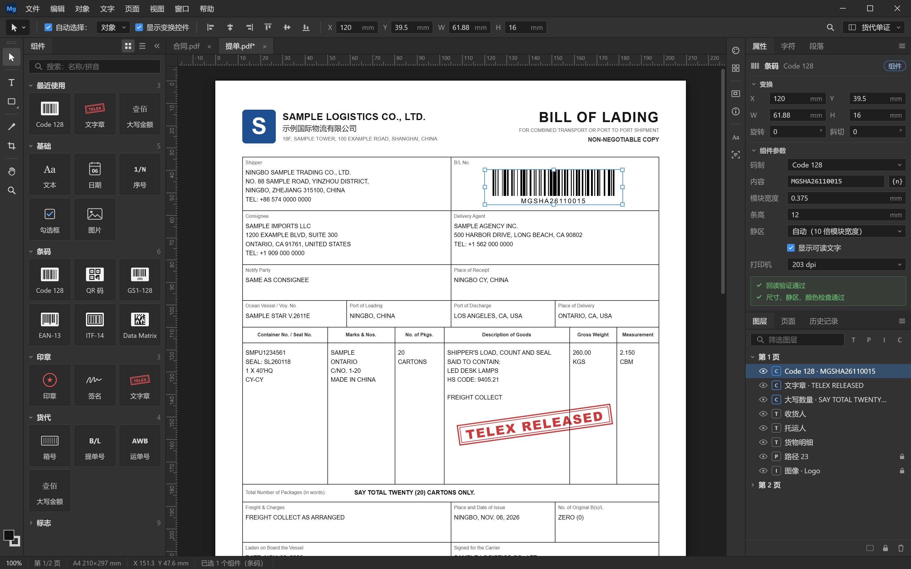
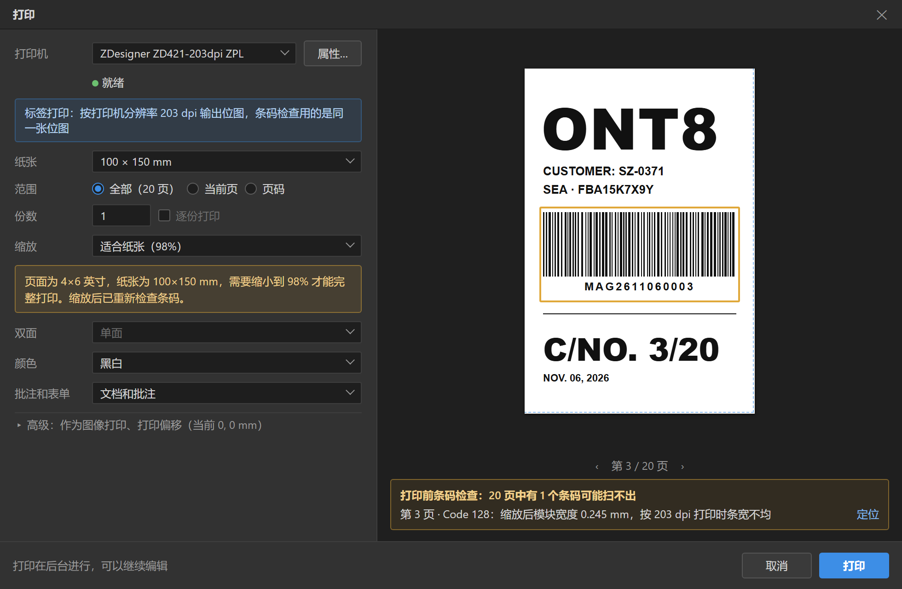
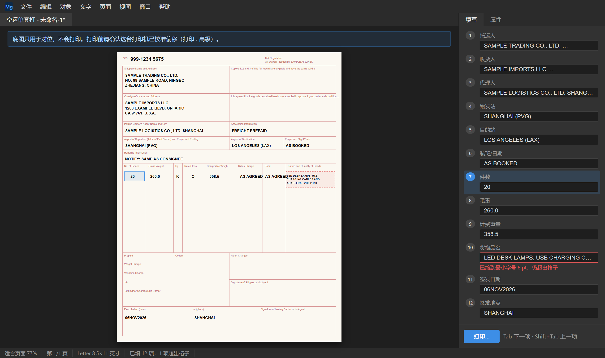

# MagPDF 用户手册

| 项 | 内容 |
|---|---|
| 适用版本 | 1.0 |
| 状态 | 草稿：按设计文档编写，开发过程中随功能更新，发布前与实际软件逐项核对（《工程规范》第 10 节） |
| 日期 | 2026-11-06 |
| 负责人 | 界面组设计人员编写，测试与工程组核对 |

---

## 1. 简介

MagPDF 是 Windows 上的 PDF 编辑器，可以：
- 像编辑设计稿一样，选中、移动、缩放、改颜色、删除页面上的任何文字、图形和图片；
- 直接修改 PDF 里的文字，支持中文；
- 识别扫描件里的文字，让扫描件可以搜索、复制；
- 用内置组件给单证加条码、二维码、印章、电放章、箱号、大写金额、包装和危险品标志；
- 按件数批量生成箱唛、进仓标签、空运标签、分拣标签，拆分平台导出的一页多张标签；
- 打印前检查条码能不能扫，在预印的提单、空运单上套打。

所有文档都在你的电脑上处理，软件不会上传你的文档。

**版本**：MagPDF 有免费版、专业版和货代版，各版本的功能见附录。安装后 14 天内可以免费使用货代版的全部功能。

## 2. 安装与激活

### 2.1 系统要求

- Windows 10（22H2）或 Windows 11，64 位
- 内存 8 GB 以上，推荐 16 GB
- 可用磁盘空间 1 GB 以上
- 屏幕分辨率 1366×768 以上

### 2.2 安装

1. 运行安装程序 `MagPDF-1.0.0-setup.exe`，按提示完成安装。不需要管理员权限。
2. 电脑不能上网时，使用完整版安装包 `MagPDF-1.0.0-full-setup.exe`，它包含全部组件。
3. 如果出现"Windows 已保护你的电脑"，点"更多信息"，确认发布者是我们公司后，点"仍要运行"。

### 2.3 激活

1. 购买后，在 MagPDF 里选 帮助 > 授权 > 复制机器码。
2. 把机器码和订单号发给我们（官网表单、邮件或客服）。
3. 收到授权文件（扩展名 `.maglic`）后，双击它，或在 帮助 > 授权 里选"导入授权文件"。

激活不需要联网。个人授权可以激活 2 台电脑；换电脑时联系客服办理迁移。

## 3. 认识界面

| 区域 | 说明 |
|---|---|
| 菜单栏 | 最上面一行：文件、编辑、对象、文字、页面、视图、窗口、帮助 |
| 选项栏 | 菜单栏下面，显示当前工具的选项；右侧可以切换工作区 |
| 工具栏 | 最左边一列：选择、文字、形状、吸管、裁剪、抓手、缩放；最下面是填充色和描边色 |
| 组件面板 | 工具栏右边：条码、印章、货代组件等，拖到页面上就能用 |
| 文档标签和画布 | 中间：每个打开的文档一个标签，没保存的带 `*` |
| 右侧面板 | 属性、字符、图层、页面、历史记录等，可以折叠成图标、拖出来浮动 |
| 状态栏 | 最下面：缩放比例、页码、纸张尺寸、光标位置、选中了什么 |

**工作区**：右上角可以切换"基础""文字编辑""页面整理""扫描件""货代单证"几种面板布局。调整好的布局可以保存为自己的工作区。

## 4. 打开、保存与恢复

- **打开**：文件 > 打开（Ctrl + O），或把 PDF 拖进窗口。有打开密码的文档需要先输入密码。
- **保存**（Ctrl + S）：只在文件末尾追加修改，速度快，原文件的其余部分保持不变。
- **另存为、优化保存**：重新写出整个文件，体积更小。
- **已签名的文档**：保存后，签名会显示为"签名后已修改"。为了保留原签名，这类文档只能用普通保存，不能优化保存。
- **自动恢复**：软件每 2 分钟在后台备份一次没保存的修改。程序意外退出时，最多丢失最近 2 分钟的修改；下次启动时会列出可以恢复的文档。

## 5. 选择和修改对象

### 5.1 选择

- 单击选中一个对象；按住 Shift 单击可以多选。
- 在空白处拖出一个框，框碰到的对象都会被选中。
- 想选被压在下面的对象：右键单击，菜单最上面列出了光标下的所有对象。
- 编组和组件单击时选中整体；双击进入里面编辑。

### 5.2 移动、缩放、旋转

- 拖动对象即可移动；按住 Shift 只沿水平、垂直或 45° 方向移动；按住 Alt 拖动会复制一份。
- 方向键每次移动 0.1 mm，按住 Shift 每次 1 mm。
- 拖四角的控制点缩放（按住 Shift 等比）；把光标放在控制点外侧拖动可以旋转（按住 Shift 每次 15°）。
- 需要精确数值时，在选项栏或属性面板里直接输入 X、Y、宽、高、角度，也可以输入算式，如 `120+10`。
- 拖动时会自动对齐页面边缘、中线和其他对象，按住 Ctrl 暂时取消对齐。

### 5.3 改颜色和线条

选中对象后，在属性面板里修改填充色、描边色、线宽、虚线和不透明度。文件里原有的印刷用颜色（CMYK、专色）会原样保留。

### 5.4 编组、层级、锁定、隐藏

- **编组**：Ctrl + G；取消编组：Ctrl + Shift + G。
- **调整层级**：Ctrl + ] 上移一层，Ctrl + [ 下移一层，Ctrl + Shift + ] 置顶，Ctrl + Shift + [ 置底；也可以在图层面板里拖动。
- **锁定**：在图层面板点锁形图标。锁定的对象在画布上点不到，避免误改。
- **隐藏**：在图层面板点眼睛图标。隐藏只影响当前这次编辑，隐藏的对象不显示也不打印；但保存后，它们在其他软件里仍然可见。

### 5.5 页面提示"无法安全修改原有内容"

少数页面用了软件尚不能完整保留的效果。为了不破坏页面，这些页面只能添加内容，不能修改原有的对象。页面缩略图上有角标，鼠标停在角标上可以看到原因。

## 6. 修改文字

- **改已有的文字**：双击文字，出现编辑框后直接修改。按 Ctrl + Enter 或在编辑框外单击完成，按 Esc 放弃修改。
- **新建文字**：用文字工具（T）在空白处单击。
- **改字体、字号、颜色**：在字符面板里修改。
- **字体被替换**：原文件里嵌入的字体不一定包含你新输入的字。这时软件会先尝试用电脑上的同名字体补上，补不上就换用相近的字体，并提示"字体已替换"，被替换的字会标出来。
- **不能修改的文字**：有些 PDF 里的文字没有字符信息，只能整体移动、缩放，不能改字。
- 段落自动换行重排将在后续版本提供；目前多行文字可以手动换行。

## 7. 页面

在页面面板里可以：
- 拖动缩略图调整页面顺序；
- 右键插入空白页、从其他文件插入页面、删除、旋转、提取为新文件；
- 用裁剪工具（C）调整页面的显示和打印范围。

把平台导出的一页多张标签拆成单张，见 11.3。

## 8. 扫描件

- 打开扫描件后，软件会自动在后台识别文字，先识别你正在看的页面，状态栏显示进度，可以暂停。
- 识别完成后，扫描件里的文字可以搜索（Ctrl + F）、选中和复制。
- 识别面板里列出识别把握不大的文字，点击可以跳到原位核对。
- 识别结果在保存文档时写进文件，以后用其他软件打开也能搜索；不想写入可以在偏好设置里关闭。
- 修改扫描件上的文字将在后续版本提供。

## 9. 组件

### 9.1 置入和修改

- 从组件面板把组件拖到页面上；或者单击组件，再在页面上单击放下，也可以拖出一个框决定大小。
- 置入后属性面板显示组件的参数，直接输入即可，页面上会马上更新。
- 组件面板顶部可以搜索，支持拼音首字母，例如输入 `dfz` 找到电放章。

### 9.2 条码和二维码

- 选择码制（Code 128、GS1-128、Code 39、EAN-13、UPC-A、ITF-14，二维码有 QR 码、Data Matrix、PDF417），输入内容。
- 参数里的"打印机分辨率"请选你实际使用的打印机（203、300 或 600 dpi），软件会让条码的每根条正好对齐打印机的打印点，打出来更容易扫。
- 缩放条码时，软件会重新生成条码，而不是把图形拉伸变形。
- 条码下方的检查结果：
  - **回读验证通过**：软件已经模拟扫描，读出的内容和你输入的一致；
  - **尺寸、静区、颜色检查通过**：条码不太小、两侧留白没有被别的东西压住、颜色能被扫描枪识别。
- 有问题时组件上会出现黄色或红色标记，属性面板里写明原因。注意：红色的条用常见的红光扫描枪读不出来。

### 9.3 印章和签名

- 印章、签名图片需要你自己导入：可以导入透明背景的 PNG，也可以从扫描件或手机照片里提取（框选印章后，软件会去掉纸张背景和压在下面的文字）。
- 盖章后，印章会像真实盖章一样叠在文字上，下面的字透得出来。
- 可以给印章库设置密码，盖章前需要输入。
- **骑缝章**：选择页码范围，软件把印章切成竖条，分别放在每一页的边缘，叠放对齐时拼成完整的印章。
- 请注意：印章图片不等于有法律效力的电子签章，使用前请确认已获得本单位授权。

### 9.4 文字章

内置 TELEX RELEASED、SURRENDERED、ORIGINAL、COPY、NON-NEGOTIABLE、FREIGHT PREPAID、FREIGHT COLLECT、SHIPPED ON BOARD（带日期）、SHIPPER'S LOAD, COUNT AND SEAL，也可以输入自定义文字。颜色、边框可调，倾斜角度用旋转调整。电放章等请在确认业务已办理后再使用。

### 9.5 货代组件

| 组件 | 说明 |
|---|---|
| 箱号/封号 | 输入集装箱号时自动检查校验位，不对时标红并给出正确的校验位 |
| 提单号 | 可同时生成条码；能认出常见船公司的代码前缀，帮助核对 |
| 空运单号 | 自动检查校验位；显示格式可选，如 `999-1234 5675` |
| 大写数量与金额 | 英文数量（SAY TOTAL TWENTY (20) CARTONS ONLY.）、英文金额、人民币大写（壹万贰仟叁佰元整） |

打开文档时，软件也会检查文档里原有的箱号、空运单号，校验位不对的会在页面上用虚线框标出。这些提示不影响保存。

### 9.6 标志

内置向上、易碎物品、怕雨、堆码层数极限、禁止翻滚等包装储运标志，以及锂电池标记、第 9 类危险品标签、仅限货机标签。
- 标志按标准规定的图形和最小尺寸绘制，不能缩小到标准以下。
- 锂电池标记的红色斜纹、仅限货机标签的橙色是规定的颜色，用黑白打印机打印时软件会提醒你。
- 请根据货物实际情况选用标志，软件不会判断货物是否属于危险品。

### 9.7 解散组件

右键 > 解散组件，组件变成普通的图形和文字，可以自由修改，但不能再通过参数修改。如果组件被其他软件改过，图层面板会提示，你可以选择按参数重新生成，或者解散。

## 10. 模板

- **存为模板**：编辑好一份文档后，选 文件 > 存储为模板…，填写名称和分类。抬头、Logo、固定条款等内容可以先在图层面板里锁定，防止以后误改。
- **从模板新建**：文件 > 新建（Ctrl + N），双击模板，就会生成一份"未命名"的副本，模板本身不会被修改。
- **修改模板**：在模板库里右键 > 编辑模板，保存后模板即更新。
- **分享模板**：模板就是普通的 PDF，可以导出发给同事；也可以在偏好设置里添加一个共享文件夹（如同步盘里的文件夹），多台电脑共用。

## 11. 标签与批量生成

### 11.1 新建标签

文件 > 新建 > 空白文档，选择标签尺寸：100×150 mm、100×100 mm、4×6 英寸、60×40 mm、50×30 mm 等，也可以自定义。

### 11.2 内置标签模板

| 模板 | 尺寸 | 主要内容 |
|---|---|---|
| 箱唛（主唛、侧唛） | 100×100 mm | 唛头、目的港、订单号、箱号序号、原产地；货号、数量、毛净重、尺寸 |
| 进仓标签 | 100×100 mm | 进仓编号和条码、件数序号 |
| 空运货物标签 | 100×150 mm | 航司、主单号和条码、目的站、件数 |
| 分拣标签 | 100×150 mm | 目的仓代码（大字）、客户代码、箱数序号、内部单号条码 |

### 11.3 按网格拆分平台标签

平台导出的 PDF 常常一页排了好几张标签。在页面面板里右键 > 按网格拆分：选择行列（或点"自动检测"），设置标签尺寸，就能拆成每张一页。拆分后软件会自动检查条码是否都能扫。

### 11.4 按序号批量生成

1. 在模板里放一个"序号"组件，例如 `C/NO. {n}/{N}`。条码等组件的内容里也可以写 `{n}`。
2. 选 文件 > 批量生成…，填写总数（如 120 箱）、起始值和步长。
3. 点"生成"。软件先逐张检查（如条码内容是否合规），没问题就在后台生成一个新文档，每张一页，可以随时取消。

按 Excel 表格批量生成、拼版到 A4 标签纸将在后续版本提供。

## 12. 打印

文件 > 打印（Ctrl + P）：
- 左边设置打印机、纸张、范围、份数、缩放、双面、颜色、是否打印批注；右边是预览。
- **缩放**默认是"实际大小"。页面和纸张尺寸不一致时，会提示需要缩放多少，例如 4×6 英寸的标签打到 100×150 mm 的纸上需要缩小到约 98%。
- **标签打印机**：软件按打印机的实际分辨率生成打印图像，条码最清晰。
- **打印前条码检查**：软件会把每页按打印效果检查一遍，找出可能扫不出的条码，列在预览下方，点"定位"可以查看。确认无误再打印。
- 打印在后台进行，打印期间可以继续编辑，还没保存的修改也会打印出来。
- 个别打印机打印效果不正常时，可以在"高级"里选"作为图像打印"。

## 13. 套打

套打是指在已经印好格式的单据（预印的提单纸、空运单、发票纸）上，只打印需要填写的内容。

### 13.1 新建套打模板

1. 文件 > 新建套打模板…，选择空白单据的扫描件或 PDF。
2. 用裁剪工具把页面裁到单据的边缘。
3. 如果扫描时有缩放，在底图上点两个点，输入它们的实际距离，软件会把底图校正到实际大小。
4. 底图会自动放进"不打印"图层并锁定。接着在单据的格子里放文本、日期、大写金额、条码等组件。
5. 选 视图 > 显示填写顺序，按你想要的顺序依次单击各个字段，设定填写顺序。
6. 存储为模板。

### 13.2 填写和打印

1. 从套打模板新建文档，右侧面板会显示"填写"页，按顺序列出所有字段。
2. 逐项填写，按 Tab 跳到下一项，按 Shift + Tab 回到上一项。内容太长时字号会自动缩小；缩到最小仍放不下的字段会标红。
3. 点"打印…"。底图只用来对位，不会打印出来；即使把模板发给别人用其他软件打印，底图也不会打出来。

### 13.3 打印校准

每台打印机的进纸位置都有一点偏差，第一次套打前请校准：
1. 在打印对话框里展开"高级"，点"打印校准页"，用白纸打印。
2. 把打出来的校准页叠在空白单据上，对着光看十字线偏了多少。
3. 把偏差填进去（向右、向下为正，单位 mm），保存。以后用这台打印机打印都会自动修正。

多联的空运单需要用针式打印机打印。请在打印机驱动里添加和单据一样大小的自定义纸张。

## 14. 常用快捷键

| 操作 | 快捷键 |
|---|---|
| 新建 / 打开 / 保存 / 打印 | Ctrl + N / Ctrl + O / Ctrl + S / Ctrl + P |
| 撤销 / 重做 | Ctrl + Z / Ctrl + Shift + Z |
| 复制对象 | Ctrl + J |
| 自由变换 | Ctrl + T |
| 编组 / 取消编组 | Ctrl + G / Ctrl + Shift + G |
| 上移一层 / 下移一层 | Ctrl + ] / Ctrl + [ |
| 置顶 / 置底 | Ctrl + Shift + ] / Ctrl + Shift + [ |
| 适合页面 / 实际大小 | Ctrl + 0 / Ctrl + 1 |
| 查找 | Ctrl + F |
| 偏好设置 | Ctrl + K |
| 工具 | V 选择、T 文字、U 形状、I 吸管、C 裁剪、H 抓手（或按住空格）、Z 缩放 |

所有快捷键都可以在偏好设置里修改。

## 15. 常见问题

**改了字以后，字体看起来不一样？**
原文件只嵌入了用到的那部分字，新输入的字可能不在里面。软件会先用电脑上的同名字体补上，补不上才换用相近的字体，并提示"字体已替换"。如果电脑上装有原来的字体，效果会更一致。

**为什么有的页面不能修改原有内容？**
这些页面用了软件尚不能完整保留的效果。为了不破坏页面外观，只允许在上面添加内容。

**已签名的文档保存后，签名为什么显示"已修改"？**
这是签名的正常表现：原签名仍然证明签名时的版本没有被改过，同时提示签名之后又有修改。软件为了不让签名失效，对这类文档只用普通保存。

**条码打印出来扫不出来？**
先看打印前条码检查的提示。常见原因：条码太小（尤其是缩放打印之后）、"打印机分辨率"参数和实际打印机不一致、条码颜色太浅或是红色、两侧留白被其他内容压住。

**套打对不齐？**
按 13.3 校准打印偏移。如果只是部分字段偏，检查底图尺寸是否已按实际距离校正。

**为什么提示锂电池标记要用彩色打印？**
锂电池标记的红色斜纹是规定的颜色。热敏标签打印机只能打黑白，建议使用预印的锂电池标签或彩色打印机。

**盖的印章有法律效力吗？**
印章图片只是图像，不等同于有法律效力的电子签章。请在获得本单位授权后使用。

**软件会上传我的文档吗？**
不会。所有处理都在你的电脑上完成。软件只在检查更新和下载可选组件时联网，这两项都可以在偏好设置里关闭。

**换了电脑，授权怎么办？**
联系客服办理迁移，我们会为新电脑签发授权文件。

**程序出错了怎么办？**
选 帮助 > 导出诊断包，把生成的文件发给客服。诊断包默认不包含你的文档内容。

## 附录：各版本功能

| 功能 | 免费版 | 专业版 | 货代版 |
|---|---|---|---|
| 阅读、搜索、打印、页面整理 | ✓ | ✓ | ✓ |
| 扫描件识别文字（搜索、复制） | ✓ | ✓ | ✓ |
| 选择、移动、修改对象，图层 | | ✓ | ✓ |
| 修改文字 | | ✓ | ✓ |
| 模板 | | ✓ | ✓ |
| 文本、日期、勾选框、图片、印章、签名、文字章组件 | | ✓ | ✓ |
| 导出图片 | | ✓ | ✓ |
| 条码、二维码、序号、货代组件、标志、骑缝章 | | | ✓ |
| 内置标签模板、批量生成、按网格拆分 | | | ✓ |
| 打印前条码检查 | | | ✓ |
| 套打 | | | ✓ |
